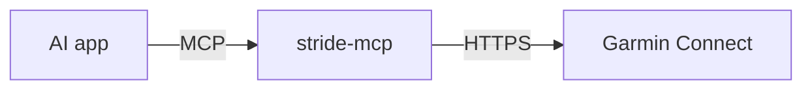

# stride-mcp

Let AI apps read my Garmin data, using [MCP](https://modelcontextprotocol.io). Works with any MCP client, such as Claude or ChatGPT.

> **Status:** early. Phase 1 (command-line login) is in progress. See [the plan](docs/project-plan.md).

## How it works



stride-mcp logs in to Garmin once, keeps the login fresh, and offers tools like "get my recent activities" to the AI app.

## Build

Needs Java 25.

```
./mvnw verify
```

## Docs

Start with [docs/README.md](docs/README.md).

## Note

This uses Garmin's unofficial phone-app login, because Garmin has no personal API. It's for accessing your own data, and it may break when Garmin changes things. See [Getting Garmin data](docs/garmin-access.md).
