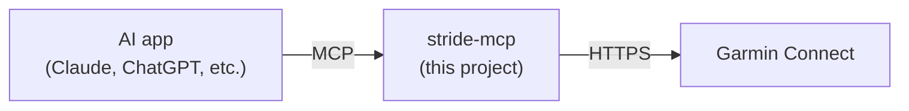

# stride-mcp docs

**Goal:** let AI tools read my Garmin data, reliably. It should work with any AI app that supports MCP, such as Claude or ChatGPT.

| Doc | Read it for |
|---|---|
| [Concepts](concepts.md) | What MCP is, and the other words we'll use |
| [Getting Garmin data](garmin-access.md) | The ways in, and their risks |
| [Project plan](project-plan.md) | What we're building, in what order |
| [Running it](running.md) | Where it runs, and how an AI app connects to it |
| [Phase 1: Login](phase-1-login.md) | Detailed plan for the command-line login |

## The short version

1. **stride-mcp** logs in to Garmin as me, and keeps that login alive.
2. It offers a set of **tools**, like "get my runs from last week" or "get last night's sleep".
3. An AI app connects to it using **MCP** and calls those tools when I ask it questions.

## The big risk

Garmin doesn't offer a personal API. We have to log in the same way the Garmin phone app does, and Garmin can change that at any time. It already did in March 2026. See [Getting Garmin data](garmin-access.md).
