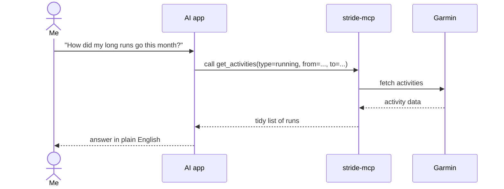

# Concepts

Plain-language explanations of the ideas this project uses.

## MCP (Model Context Protocol)

A standard way for AI apps to use outside tools and data.

Think of it like **USB for AI**. Without it, every AI app needs custom code for every service. With MCP, you build one **server**, and any AI app that speaks MCP can plug into it.

| Part | What it is | Here |
|---|---|---|
| **Host** | The AI app you chat with | Claude Desktop, Claude Code, others |
| **Client** | The part of the host that talks MCP | Built into the host, nothing for us to build |
| **Server** | A program that offers tools and data | **stride-mcp** (what we build) |

## What a server offers

| Type | What it is | Example |
|---|---|---|
| **Tools** | Actions the AI can call, with inputs | `get_activities(from, to)` |
| **Resources** | Data the AI can read, like files | "My training zones" |
| **Prompts** | Ready-made instructions a user can pick | "Summarise my training week" |

Tools are the main one. Each tool has a name, a plain-English description, and a list of inputs. **The AI reads the description to decide when to call the tool**, so good descriptions matter.

## How a question flows

The AI never talks to Garmin directly, and never sees my password.

## Transports: how the AI app connects

| Transport | How it works | Good for |
|---|---|---|
| **stdio** | The AI app starts our server as a program on my computer and talks to it directly | Personal use on one machine. Simplest. |
| **Streamable HTTP** | Our server runs as a web service, and the AI app connects over the network | Using it from several devices, or hosting it. **ChatGPT only supports this.** |

We'll start with **stdio**, and can add HTTP later without rewriting the tools. See [Running it](running.md).

## Login words

| Word | Meaning |
|---|---|
| **SSO** | Garmin's login page (`sso.garmin.com`). The same one the phone app uses. |
| **MFA** | The extra one-time code Garmin may ask for |
| **Access token** | A short-lived pass that proves "this is James" on each request |
| **Refresh token** | A longer-lived pass used to get a new access token, so I don't have to log in again |

The plan: log in **once** from the command line, save the tokens on my machine, and let the server refresh them by itself.

## Spring AI

The Java library we'll use to build the MCP server. It handles the MCP protocol, so we mostly just write normal Java methods and mark them as tools. Spring AI 2.0 works with Spring Boot 4, which is what this project uses.
