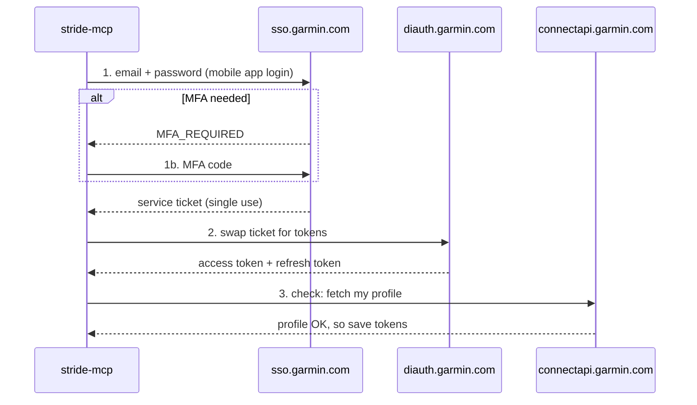
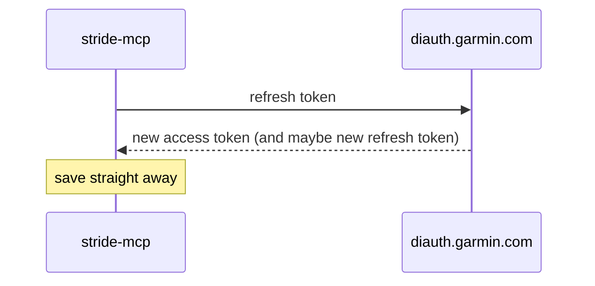

# Phase 1: Log in from the command line

**Goal:** log in to Garmin once from the terminal, save the tokens, and keep them working without logging in again.

**Done when:**

- `login` works, including the MFA code if Garmin asks for one
- `whoami` still works days later, with no password needed
- My password is never saved or logged

## The commands

All three run from the same jar that will later be the MCP server.

| Command | What it does |
|---|---|
| `stride-mcp login` | Asks for email, password and (if needed) MFA code. Saves tokens. |
| `stride-mcp whoami` | Uses the saved tokens to fetch my Garmin profile name. Refreshes them if needed. |
| `stride-mcp logout` | Deletes the saved token file. |

The password is typed at a hidden prompt. It's never passed as a command argument (those end up in shell history) and never written to disk.

## How the Garmin login works

Based on how the current python-garminconnect library does it (October 2026):



Later, when the access token is about to expire:



**Details worth knowing:**

- The access token is a JWT, so we can read its expiry time ourselves. We refresh 15 minutes before it runs out.
- Garmin uses several app "client IDs" for the token swap, and they change over time. We try a short list in order, and keep that list in one place so it's easy to update.
- If Garmin asks for a CAPTCHA, or blocks us with a 403 or 429, we **stop and explain**. We don't retry in a loop, because repeated logins can lock the account.

## The main risk: getting through Cloudflare

Garmin's login sits behind Cloudflare bot protection. The Python library spoofs browser connection details to get through. Java's built-in HTTP client can't do that.

Other projects report that plain clients sometimes still work, so **step 1 is a quick test** before building anything properly.

| If the test… | Then |
|---|---|
| Works | Carry on with the plan below |
| Gets blocked (403 or CAPTCHA) | Try fixes in order: match the app's headers and HTTP version more closely; add the short delays the Python library uses; try Garmin's other (web widget) login flow. If none work, come back and decide together. |

## Code layout

```
com.stride.mcp
├── cli/          login, whoami, logout commands
└── garmin/auth/
    ├── GarminSsoClient      step 1: email, password, MFA → service ticket
    ├── DiTokenClient        step 2 + refresh: ticket → tokens
    ├── TokenStore           read/write the token file safely
    ├── TokenManager         "give me a valid access token", refreshing if needed
    └── GarminAuthConfig     URLs, client IDs, user agents (the bits Garmin changes)
```

**Tools:** Java's built-in HTTP client and Jackson (already part of Spring Boot). No new libraries are needed for phase 1.

The jar won't start a web server in phase 1. The commands just run and exit.

## Where tokens are saved

`~/.stride-mcp/garmin_tokens.json`

| Rule | Why |
|---|---|
| Folder readable only by me (`700`), file too (`600`) | The refresh token gives full account access |
| Write to a temp file, then swap it in | A crash mid-write can't corrupt the tokens |
| Contains: access token, refresh token, client ID | Nothing else. No password, no email. |

Moving this to the macOS Keychain is a possible future improvement. `TokenStore` is the only class that would change.

## Errors I should see

| Situation | Message (roughly) |
|---|---|
| Wrong password | "Garmin rejected the email or password." |
| Wrong MFA code | "MFA code not accepted. Run `login` again." |
| Blocked (403, CAPTCHA) | "Garmin blocked the login (bot protection). Wait a while, then try again." |
| Rate limited (429) | "Too many attempts. Wait before trying again." |
| No token file | "Not logged in. Run `stride-mcp login`." |
| Refresh token rejected | "Session expired. Run `stride-mcp login`." |

Tokens, tickets and passwords are never printed in messages or logs.

## Steps

1. **Cloudflare test:** a throwaway test that tries step 1 of the login with Java's HTTP client. Record what happens, plus token lifetimes if it works.
2. **Project setup:** command handling (`login`, `whoami`, `logout`) and no web server for now.
3. **TokenStore:** safe file read and write, with tests for permissions and the temp-file swap.
4. **GarminSsoClient:** email and password login, plus MFA.
5. **DiTokenClient:** ticket-for-tokens swap, and refresh.
6. **TokenManager + whoami:** load tokens, refresh if close to expiry, save, then fetch my profile.
7. **Tests:** each client tested against a fake Garmin server (no real logins), covering success, MFA, wrong password, 403, 429 and an expired refresh token.
8. **Live check:** log in for real, run `whoami` over several days, and update these docs with what we learn.

## Not in phase 1

- Fetching activity, sleep or other data (phase 2)
- The MCP server (phase 3)
- Keychain storage
- Garmin China accounts (`garmin.cn`)
- Backup login methods, unless the Cloudflare test forces them

## Credit

The login flow is based on [python-garminconnect](https://github.com/cyberjunky/python-garminconnect) (MIT licence). We rewrite it in Java rather than copying code.
