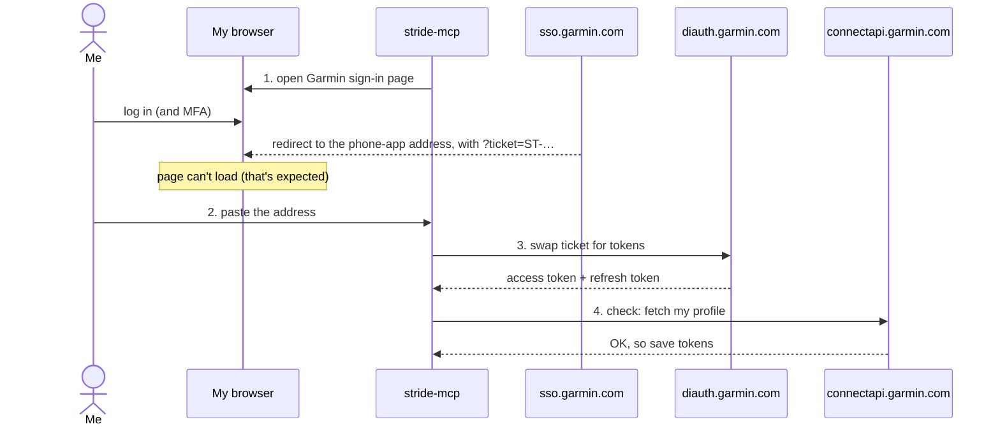
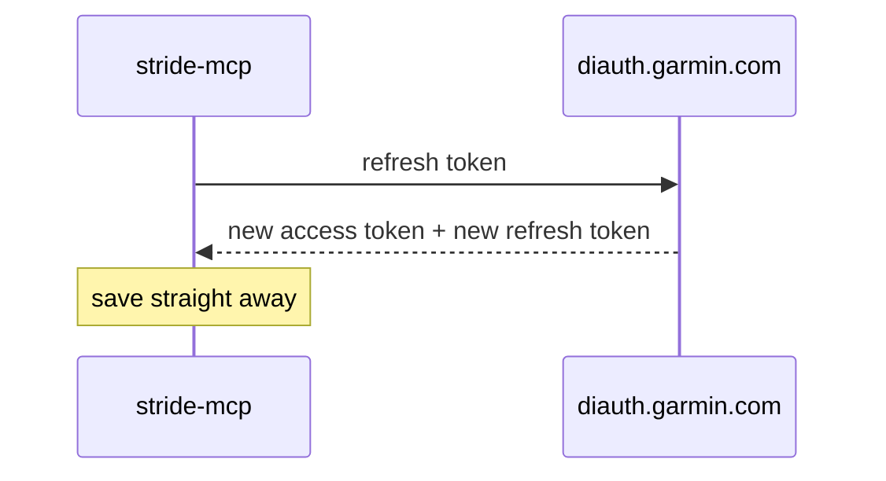

# Phase 1: Log in from the command line

**Goal:** log in to Garmin once, save the tokens, and keep them working without logging in again.

**Done when:**

- `login` works, including MFA
- `whoami` still works days later, with no new login
- stride-mcp never sees my password

## The commands

All three run from the same jar that will later be the MCP server.

| Command | What it does |
|---|---|
| `stride-mcp login` | Opens Garmin's sign-in page in my browser. I log in there and paste back the address I end up on. Saves tokens. |
| `stride-mcp whoami` | Uses the saved tokens to fetch my Garmin profile. Refreshes them if needed. |
| `stride-mcp logout` | Deletes the saved token file. |

## How the login works

I log in with **my own browser**, on Garmin's real sign-in page. stride-mcp only receives a single-use **ticket**, then swaps it for tokens.



Later, when the access token is about to expire:



### What the browser sees

1. stride-mcp opens `https://sso.garmin.com/sso/login?service=https://mobile.integration.garmin.com/gcm/ios`. This is Garmin's classic sign-in form, and Garmin's MFA works on it as normal.
2. After login, Garmin redirects to `mobile.integration.garmin.com/gcm/ios?ticket=ST-…`. That address normally opens the Garmin phone app, so a browser can't load it. Safari shows "This Connection Is Not Secure". **Don't click Continue.** Just copy the address.
3. If the browser is already signed in to Garmin, step 1 skips the form and redirects straight away.

## Why the browser, not a password prompt

We first tried sending email and password straight to Garmin's phone-app login, the way python-garminconnect does. It failed:

| Finding (October 2026) | Detail |
|---|---|
| Java gets through Cloudflare | A fake login got a proper "wrong password" reply, not a bot challenge |
| …but Garmin then rate-limits | HTTP 429 after 2 attempts. Still 429 an hour later. |
| It's not about attempts | Garmin rate-limits based on the **client's connection fingerprint**, even from fresh networks ([python-garminconnect #449](https://github.com/cyberjunky/python-garminconnect/pull/449), [#453](https://github.com/cyberjunky/python-garminconnect/issues/453)). Python gets around it by imitating a browser's connection. Java can't. |

A real browser avoids all of that, and handles MFA and CAPTCHAs for free. As a bonus, stride-mcp never sees my password.

Two things that don't work in a browser:

- **The phone-app sign-in page** (`/mobile/sso/en_US/sign-in`) hangs on `/portal/sso/embed`, waiting for the phone app to take over.
- **Normal Garmin website sign-in**: the website uses up the ticket immediately, and tickets only work once.

## Token facts (measured October 2026)

| | Lifetime | Notes |
|---|---|---|
| **Access token** | ~21 hours | A JWT, so we can read its expiry ourselves. Refresh 15 minutes before it runs out. |
| **Refresh token** | 30 days | Each refresh returns a **new** refresh token |
| **Ticket** | At least several minutes, if unused | Single use. No need to rush the paste. |

**So:** if stride-mcp refreshes at least once every 30 days, I should never need to log in again. Phase 1's live check confirms this over time.

**Other details:**

- Garmin uses several app "client IDs" for the token swap, and they change over time. We try a short list in order (`…_DI_2025Q2` worked first time), and keep the list in one place.
- The refresh must use the client ID inside the access token, not just whichever one we tried first.
- The profile's `displayName` is an ID number, not my name. `whoami` should show a friendlier field.

## Code layout

```
com.hammez.stride
├── cli/          login, whoami, logout commands
└── garmin/auth/
    ├── BrowserLogin         opens sign-in page, reads pasted address → ticket
    ├── DiTokenClient        ticket → tokens, and refresh
    ├── TokenStore           read/write the token file safely
    ├── TokenManager         "give me a valid access token", refreshing if needed
    └── GarminAuthConfig     URLs, client IDs, headers (the bits Garmin changes)
```

**Tools:** Java's built-in HTTP client and Jackson (already part of Spring Boot). No new libraries.

The jar won't start a web server in phase 1. The commands just run and exit.

## Where tokens are saved

`~/.stride-mcp/garmin_tokens.json`

| Rule | Why |
|---|---|
| Folder readable only by me (`700`), file too (`600`) | The refresh token gives full account access |
| Write to a temp file, then swap it in | A crash mid-write can't corrupt the tokens |
| Contains: access token, refresh token, client ID, expiry times | Nothing else. No password, no email. |

Moving this to the macOS Keychain is a possible future improvement. `TokenStore` is the only class that would change.

## Errors I should see

| Situation | Message (roughly) |
|---|---|
| Pasted text has no ticket | "No ticket found. Copy the full address from the browser's address bar." |
| Ticket rejected (expired or already used) | "Garmin didn't accept that ticket. Run `login` again." |
| All client IDs rejected | "Garmin rejected the token swap. Its app IDs may have changed. Check for an update." |
| Rate limited (429) | "Garmin is rate limiting. Wait before trying again." |
| No token file | "Not logged in. Run `stride-mcp login`." |
| Refresh token rejected or expired | "Session expired. Run `stride-mcp login`." |

Tickets and tokens are never printed in messages or logs.

## Steps

1. ~~**Cloudflare test**~~: done (see above). Led to the browser login.
2. **Project setup:** command handling (`login`, `whoami`, `logout`) and no web server for now.
3. **TokenStore:** safe file read and write, with tests for permissions and the temp-file swap.
4. **BrowserLogin:** open the sign-in page, read the pasted address, pull out the ticket.
5. **DiTokenClient:** ticket-for-tokens swap, and refresh.
6. **TokenManager + whoami:** load tokens, refresh if close to expiry, save, then fetch my profile.
7. **Tests:** each part tested against a fake Garmin server (no real logins), covering success, bad paste, rejected ticket, unknown client IDs, 429 and an expired refresh token.
8. **Live check:** log in for real, run `whoami` over several days, and update these docs with what we learn.

## Not in phase 1

- Fetching activity, sleep or other data (phase 2)
- The MCP server (phase 3)
- Keychain storage
- Garmin China accounts (`garmin.cn`)
- Password-based login (blocked for Java clients, see above)

## Credit

The token swap and refresh are based on [python-garminconnect](https://github.com/cyberjunky/python-garminconnect) (MIT licence). We rewrite them in Java rather than copying code.
