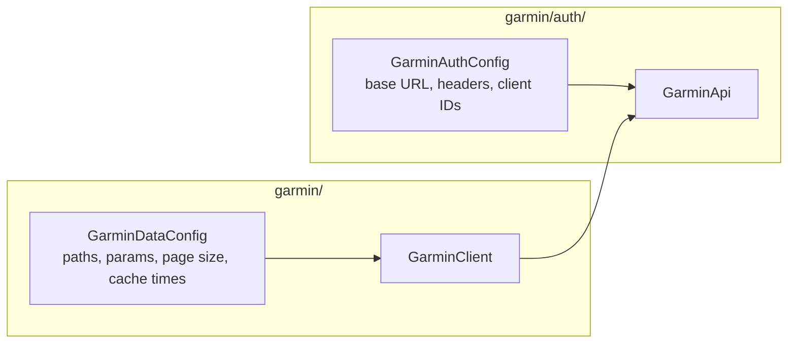
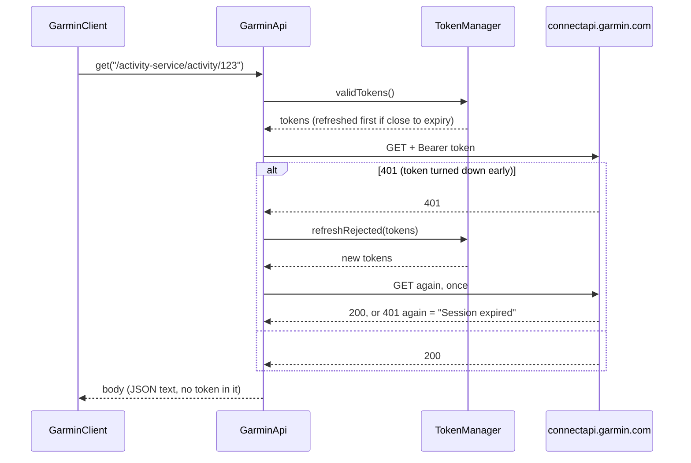
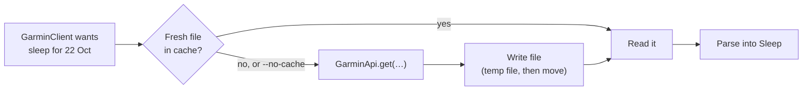

# Phase 2: Fetch real data

**Goal:** read my activities, one activity's details, a daily summary and last night's sleep from Garmin, and keep the results in a cache so we don't ask Garmin twice.

**Done when:** `stride-mcp activities --days 7 --type running` prints last week's runs.

_Status: plan approved 23 October 2026. Steps 2 (`GarminApi`), 3 (`capture`), 4 (records and `GarminClient`), 5 (`GarminCache`) and 6 (the CLI commands) built and tested. Real samples captured 23 October 2026. Step 7 (docs) done 24 October 2026. Next: the owner's live check (step 8)._

## The commands

Same jar and same style as phase 1. These are for testing. In phase 3 the same calls become MCP tools.

| Command | What it prints |
|---|---|
| `stride-mcp activities [--days N] [--type T]` | My activities from the last N days (default 7, at most 90), newest first. `--type running` keeps only runs. |
| `stride-mcp activity <id>` | One activity: totals, heart rate, training effect, and each lap. The id is in the `activities` list. |
| `stride-mcp summary [YYYY-MM-DD]` | One day's totals: steps, calories, heart rate, stress, Body Battery. Default today. |
| `stride-mcp sleep [YYYY-MM-DD]` | The night that **ended** on that morning: times, stages, score. Default last night. |
| `stride-mcp capture <folder>` | Saves Garmin's raw replies to files, for building test fixtures. See [Getting real samples](#getting-real-samples). |

| Option | What it does |
|---|---|
| `--no-cache` | Ask Garmin even if the cache has a fresh copy (the new reply is still cached) |
| `--stride.token-file=…` | As in phase 1 |
| `--stride.cache-dir=…` | Keep the cache somewhere else (default `~/.stride-mcp/cache`) |

The commands print metric units: km with 2 decimals, `h:mm:ss` or `m:ss`, pace as `min:ss /km`. The records underneath always use metres and seconds. A value Garmin left out is `–` in a table and left out of a list, never `null`. Garmin sends `0` for the distance, speed and moving time of activities without them (strength training, indoor cycling), so for activities a `0` there is `–` too.

### What they print (built 24 October 2026)

From the fixtures in `src/test/resources/garmin/` (real replies, stripped). Columns are as wide as their widest value, two spaces apart.

```
$ stride-mcp activities --days 7 --type running
Date        Type     Name               Distance  Time   Pace      Avg HR  Id
Thu 22 Oct  running  Islington Running   5.05 km  36:01  7:08 /km  143     24810777073
Sun 18 Oct  running  Islington Running   8.01 km  53:51  6:43 /km  149     24765567036
2 running activities in the last 7 days (Sat 17 Oct to Fri 23 Oct).
```

The last line shows the date range, so you can see which "today" was used.

```
$ stride-mcp activity 24816092240
Stair Stepper
Start            Thu 22 Oct 2026, 17:04
Type             stair_climbing
Id               24816092240
Time             10:02
Heart rate       avg 142, max 158 bpm
Calories         133 kcal
Training effect  2.0 aerobic, 0.0 anaerobic
Training load    22

Lap  Distance  Time   Pace  Avg HR  Max HR  Elevation
1           –  10:02  –     142     158     –
```

A run also shows `Distance`, `Time 36:01 (moving 35:51)`, `Pace 7:08 /km, fastest 4:30 /km`, `Elevation gain`, `Cadence … steps/min` and `Power … W`, and its laps fill in distance and pace. The start is the time on the clock where the activity happened.

```
$ stride-mcp summary 2026-10-23
Fri 23 Oct 2026
Steps            3,532 (goal 11,190)
Distance         3.18 km
Calories         1,417 kcal (222 active)
Heart rate       resting 45, min 43, max 130 bpm
Stress           average 20 (0–100)
Body Battery     lowest 30, highest 96
Intensity        0 min moderate, 2 min vigorous
Floors climbed   7
```

A day with no data at all prints `No data recorded for Sat 24 Oct 2026.` Floors are rounded down, because Garmin counts part floors.

```
$ stride-mcp sleep 2026-10-23
Night ending Fri 23 Oct 2026
Start            Thu 22 Oct, 22:37
End              Fri 23 Oct, 07:37
Asleep           8:52:00
  Deep           1:31:00
  Light          4:55:00
  REM            2:26:00
Awake            0:08:00
Score            91 (Excellent)
Respiration      12 breaths/min
SpO2             97% average
```

Sleep durations are always `h:mm:ss`, so 8 minutes awake (`0:08:00`) can't be read as 8 hours. Start and end are in the Garmin profile's time zone.

If the cache can't be used (see [How it works](#how-it-works-built-23-october-2026)), a data command prints why as one line on stderr, then still answers by asking Garmin.

### How options are read (decided 24 October 2026)

Spring Boot reads `--name=value` as one option, but splits `--days 7` into an option with no value and a separate `7`, and it doesn't keep the order needed to pair them up again. So stride-mcp reads the raw command line itself:

| Rule | Why |
|---|---|
| `--days 7` and `--days=7` both work, and so do `--type running` and `--type=running` | The plan shows the space form. The `=` form is what Spring users expect. |
| Options can go anywhere: `stride-mcp --no-cache sleep` works | No reason to be strict |
| An option with a dot in its name (`--stride.token-file=…`, `--logging.level.root=…`) is skipped | It's a Spring setting, and Spring has already read it |
| Any other unknown option is an error (exit 2) | A typo like `--day 7` shouldn't be silently ignored |
| An option on a command that doesn't use it (`whoami --no-cache`, `summary --days 3`) is an error | Same |
| An option given twice is an error | Which one was meant? |
| `--help` anywhere prints the usage | Spring used to swallow it as an option |

## Where each kind of data comes from

_Taken from python-garminconnect's code as of commit `5ddb9ee` (16 October 2026, its "Next Gen" rewrite). Checked 23 October 2026._

All of these are `GET` requests to `https://connectapi.garmin.com`, with the same phone-app headers and `Authorization: Bearer …` as phase 1's profile check.

| Data | Path | Query | Notes |
|---|---|---|---|
| **Who I am** | `/userprofile-service/socialProfile` | | Already used by `whoami`. Gives `displayName`, which the daily endpoints need in their path. |
| **My time zone** | `/userprofile-service/userprofile/personal-information/{displayName}` | | `timeZone`, for example `Europe/London`. See [Dates and time zones](#dates-and-time-zones). |
| **Activities** | `/activitylist-service/activities/search/activities` | `startDate`, `endDate` (YYYY-MM-DD), `start`, `limit`, optional `activityType` | A JSON list, newest first. Paged: `start` is the offset. |
| **One activity** | `/activity-service/activity/{activityId}` | | Totals are inside `summaryDTO`. 404 if the id doesn't exist. |
| **Its laps** | `/activity-service/activity/{activityId}/splits` | | Laps are in `lapDTOs`. |
| **Daily summary** | `/usersummary-service/usersummary/daily/{displayName}` | `calendarDate` (YYYY-MM-DD) | `privacyProtected: true` means Garmin refused. |
| **Sleep** | `/wellness-service/wellness/dailySleepData/{displayName}` | `date` (YYYY-MM-DD), `nonSleepBufferMinutes=60` | Main data in `dailySleepDTO`. |

What python-garminconnect does that we copy (as behaviour, not code):

- `displayName` is URL-encoded before it goes in a path.
- HTTP 204 means "no data", not an error.
- HTTP 404 is "not found", separate from other errors.
- A 401 triggers one refresh and one retry.
- Activities are fetched in pages of 20 until a page comes back empty. We stop earlier: when a page has fewer than 20, it was the last one. We also stop after 10 pages (200 activities) with a clear error, instead of paging forever.

### What the real replies showed (23 October 2026)

From the owner's `capture` run. The fixtures made from it are in `src/test/resources/garmin/`.

| Reply | Finding |
|---|---|
| Time zone | `timeZone` is at the top level (also in `userInfo.timeZone`), for example `Europe/London` |
| Activity list | Times look like `2026-10-22 07:06:50`. The type is in `activityType.typeKey`. Heart rate and calories are decimals (`143.0`). |
| One activity | Times look like `2026-10-22T07:06:50.0`. The type is in `activityTypeDTO.typeKey`, the totals in `summaryDTO`. The aerobic training effect is called `trainingEffect`. |
| Activities without distance | Strength training, stair stepper, indoor cycling: Garmin sends `0.0` for distance and speed, and leaves out elevation |
| Empty activity search | 200 with `[]`, not 204 |
| Laps | In `lapDTOs`, numbered by `lapIndex` |
| Daily summary | `totalSteps`, `dailyStepGoal`, `totalDistanceMeters`, `bodyBatteryHighestValue`… `privacyProtected: false` on both days |
| Sleep | Start and end are epoch milliseconds (`sleepStartTimestampGMT`). The score is `sleepScores.overall.value`, its label `qualifierKey`. `sleepTimeSeconds` = deep + light + REM. |
| A night with no sleep | **200, not 204**, with a `dailySleepDTO` whose fields are all null |

**Still to confirm:** the newest activity was a stair stepper session, so a run's detail fields weren't seen: cadence, power and per-lap elevation. The parser accepts the likely names (`averageRunCadence`, `averagePower`, `elevationGain`) and the list's names (`averageRunningCadenceInStepsPerMinute`, `avgPower`). Capturing again after a run (into a new folder) would settle it. Also still open: whether `activityType=running` also returns trail and treadmill runs.

## Where the paths live

A new record, `GarminDataConfig`, in `com.hammez.stride.garmin`, beside the data client. It holds every path, query parameter name, page size, page limit and cache lifetime from this doc. Nothing else hard-codes them.

The Garmin address itself (`https://connectapi.garmin.com`) and the headers stay in `GarminAuthConfig`, because auth is what sends the requests. The `socialProfile` path is shared with the login's profile check, so `GarminDataConfig` takes it from `GarminAuthConfig`.

Paths are templates (`/activity-service/activity/{activityId}`). `GarminDataConfig.fill(…)` puts the id or display name in, encoded with `GarminApi.segment(…)`. Step 3 added the paths and query names `capture` needs, step 4 the page limit, and step 5 the cache lifetimes (`GarminDataConfig.CacheLifetimes`).



## Signed-in calls without seeing a token

The rule: nothing outside `garmin/auth` touches tokens. So `garmin/auth` gets one new public class, **`GarminApi`**, that sends a request and adds the login itself.

```java
public class GarminApi {
    /** GET a connectapi path. Returns the body ("" for 204). */
    public String get(String path, Map<String, String> query);
}
```

The data client builds the path and query. `GarminApi` gets a valid token from `TokenManager`, adds the headers, sends the request and reads the status.



| Garmin replies | `GarminApi` does |
|---|---|
| 200 | Returns the body |
| 204 | Returns `""`. The client reads that as "no data". |
| 401 | Refreshes **once**, retries **once**. A second 401 is "Session expired. Run `stride-mcp login`." If the token was refreshed a moment ago (it was close to expiry), there is no second refresh: the 401 is "Session expired" straight away. |
| 403 | Stops: "Garmin refused the request… wait a while" (as phase 1) |
| 404 | Throws `NotFoundException`. The client words it, for example "No activity with id 123." |
| 429 | Stops: "Garmin is rate limiting…" (as phase 1) |
| 5xx, anything else | Stops, showing the status and a short, redacted bit of the reply |
| Can't connect, timeout | Stops: "Couldn't reach Garmin…" (as phase 1) |

No other retries, and never two refreshes for one request. Error text goes through `Redactor`, with every access token sent for that request as a known secret.

**Small tidy-ups in `garmin/auth` that come with this:**

- `whoami` moves onto `GarminApi`, so the "refresh once on 401" logic lives in one place. `login` keeps calling `ProfileClient` directly, because its new tokens aren't saved yet.
- Rename `GarminAuthException` to **`GarminException`**. Data errors (404, odd replies) aren't login errors, but the CLI should catch them all in one place. All the existing subclasses stay.
- `GarminApi` refuses a path that isn't plain (no `..`, `?` or `#`, even percent-encoded), so an id or display name can't change which address is called. `GarminApi.segment(…)` encodes those parts. A refused path is a clear error, not a crash.
- Path parts and query values use the same percent-encoding (a space is `%20`). Query parameters are sent in sorted order, so the same request always has the same address.
- The profile check only passes with a JSON profile. An empty reply (204) or a page that isn't JSON is an error, so `login` never saves tokens that weren't shown to work.
- `GarminException` and `NotFoundException` stay in `garmin/auth`, the lowest layer, so `auth` never depends on the layers above it. Higher layers may catch them; they still never see tokens.

## What each call returns

Java records in `com.hammez.stride.garmin`. Only the useful fields, named for a reader, with the unit in the name. A field Garmin leaves out becomes `null`, never `0`. (Garmin itself sends `0.0` for the distance of a strength session, and that's kept.)

`GarminReplies` does the parsing. The overall shape is strict: a reply that isn't an object or list, or an activity with no id, is an `UnexpectedReplyException`. Single fields are lenient: missing, null or the wrong type becomes `null`. A 0–100 value outside that range (Garmin uses negatives for "no data") becomes `null`. `displayName` and the time zone come from the cache, like everything else.

```java
record ActivitySummary(
        long id,
        String name,
        String type,                     // Garmin's typeKey: "running", "trail_running", "cycling"…
        LocalDateTime startLocal,        // wall-clock time where the activity happened
        Instant start,
        Double distanceMetres,
        Double durationSeconds,
        Double movingDurationSeconds,
        Double elevationGainMetres,
        Double averageSpeedMetresPerSecond,
        Integer averageHeartRateBpm,
        Integer maxHeartRateBpm,
        Integer kilocalories) {}

record ActivityDetails(
        ActivitySummary summary,
        Double maxSpeedMetresPerSecond,
        Double averageCadenceStepsPerMinute,
        Integer averagePowerWatts,
        Double aerobicTrainingEffect,    // 0.0–5.0
        Double anaerobicTrainingEffect,  // 0.0–5.0
        Double trainingLoad,
        List<Lap> laps) {}

record Lap(
        int number,                      // 1, 2, 3…
        Double distanceMetres,
        Double durationSeconds,
        Double averageSpeedMetresPerSecond,
        Integer averageHeartRateBpm,
        Integer maxHeartRateBpm,
        Double elevationGainMetres) {}

record DailySummary(
        LocalDate date,
        Integer steps,
        Integer stepGoal,
        Double distanceMetres,
        Integer totalKilocalories,
        Integer activeKilocalories,
        Integer restingHeartRateBpm,
        Integer minHeartRateBpm,
        Integer maxHeartRateBpm,
        Integer averageStressLevel,      // 0–100
        Integer bodyBatteryHighest,      // 0–100
        Integer bodyBatteryLowest,
        Integer moderateIntensityMinutes,
        Integer vigorousIntensityMinutes,
        Double floorsClimbed) {}

record Sleep(
        LocalDate date,                  // the morning the night ended
        Instant start,
        Instant end,
        Integer sleepSeconds,            // asleep, not counting awake time
        Integer deepSeconds,
        Integer lightSeconds,
        Integer remSeconds,
        Integer awakeSeconds,
        Integer score,                   // 0–100
        String quality,                  // Garmin's label: "EXCELLENT", "GOOD", "FAIR", "POOR"
        Double averageRespirationBreathsPerMinute,
        Double averageSpo2Percent) {}
```

| Method on `GarminClient` | Returns |
|---|---|
| `activities(LocalDate from, LocalDate to, String type)` | `List<ActivitySummary>`, empty if none. `type` may be null. |
| `activity(long id)` | `ActivityDetails`. `NotFoundException` if there's no such activity. |
| `dailySummary(LocalDate date)` | `DailySummary`. Fields are null for a day with no data. |
| `sleep(LocalDate date)` | `Optional<Sleep>`, empty if no sleep was recorded that night |
| `today()` | Today's date in my Garmin time zone |

`summary` includes the day's step total because it's in the same reply. Detailed step data is out of scope.

## Dates and time zones

Garmin's daily endpoints take a plain local date (`2026-10-22`), and Garmin decides what that date means in **the time zone in my Garmin profile**. python-garminconnect added this in October 2026, after "today" kept returning yesterday's data on machines set to UTC.

| Word | Means |
|---|---|
| **Today** | Today's date in my Garmin profile's time zone. If that can't be read, the computer's time zone. |
| **Last N days** | Today and the N−1 days before it. `--days 7` on Fri 23 Oct = Sat 17 Oct to Fri 23 Oct. Not "last calendar week". |
| **Sleep for a date** | The night that ended on that morning. `sleep 2026-10-23` = the night of 22–23 October. So `sleep` with no date = last night. |
| **Times shown** | Sleep start and end: in the Garmin profile's time zone. An activity's start: the time on the clock where it happened. |
| **An activity's time** | `startLocal` is the time on the clock where I did it (from Garmin's `startTimeLocal`). `start` is the exact moment (from `startTimeGMT`). |

The `activities` search filters by start date, in the time zone where each activity happened. _To confirm with real samples._

The profile time zone costs one extra call, so it's cached for a week along with `displayName`.

## Caching

A CLI run is one short process, so a memory-only cache would be empty each time. The cache is **files on disk**, read before every call. In phase 3 the MCP server is a long-running process and can add a memory layer in front of the same files.

`~/.stride-mcp/cache/`, one JSON file per reply, named after what it holds (`activity-20123456789.json`, `sleep-2026-10-22.json`). We cache Garmin's raw reply, not our records, so changing a record doesn't need a cache clear-out.

| What | Kept for | Why |
|---|---|---|
| `displayName` and time zone | 7 days | Almost never change |
| One activity, and its laps | 7 days | Finished activities rarely change (renaming is the usual edit) |
| Activity list, range ends before yesterday | 1 day | Late uploads and edits are possible but rare |
| Activity list, range includes today or yesterday | 10 minutes | A new activity can sync at any time |
| Daily summary or sleep, today or yesterday | 15 minutes | Still changing as the watch syncs |
| Daily summary or sleep, older days | 30 days | Finished |
| An empty reply for an older day | 1 hour | A watch might sync old data late |
| Errors | Never cached | |



| Rule | Why |
|---|---|
| Folder `700`, files `600`, atomic writes, no symlinks (same as the token file) | It's personal data: names, heart rate, GPS start points |
| `logout` deletes the cache too | Logging out should leave no personal data behind |
| Files past their lifetime are deleted when found | Keeps the folder small |
| `--stride.cache-dir=…` moves it | Matches `--stride.token-file` |
| A broken cache file is ignored and replaced | The cache must never be the reason a command fails |

The class is `GarminCache` in `com.hammez.stride.garmin`. It never sees tokens: only replies.

### How it works (built 23 October 2026)

| Detail | Choice |
|---|---|
| File names | `social-profile.json`, `personal-information.json`, `activity-<id>.json` and `activity-<id>-splits.json`, `summary-<date>.json`, `sleep-<date>.json`, `activities-<from>-to-<to>[-<type>]-page-<n>.json` |
| What a file holds | `{"savedAt": …, "expiresAt": …, "body": "<Garmin's reply, as text>"}`. An empty reply (204) is `""`. |
| When the lifetime is decided | When the reply is saved. So a day saved while it was "yesterday" lasts 15 minutes, even once it's older. |
| "Empty" | No sleep that night, a summary with every value null, or an activity list with none in it |
| What is saved | Only a reply that was read without error. Errors, 404s, `privacyProtected` and replies we don't understand are never saved. |
| Activity lists | One file per page. A search only comes from the cache if every page it needs is there; otherwise all its pages are fetched again. "Today" (so the profile) is looked up before the first page, so a profile error can't waste a download. |
| An activity | From the cache only if both files (the activity and its laps) are fresh |
| A clock turned back | A file saved "in the future" isn't trusted |
| A broken file | Not our format, or a reply that no longer reads: deleted, then fetched again. Deleted even if that fetch fails. |
| `displayName` and time zone in memory | Also remembered by each `GarminClient` for 7 days, so a run looks them up once, even if the cache can't be used or the time zone lookup is a 404 |
| Whose folder | The cache only uses a folder it made: it writes a `.stride-mcp-cache` marker file when it creates one. An existing folder without the marker (yours, or the token folder) is never used, tightened or cleared. |
| A folder that can't be used | Someone else's, a symlink, or no Unix permissions: nothing is read or saved, and the command still works by asking Garmin. `GarminCache.problem()` says why. |
| Its own folder, loosened later | Tightened to `700` again, as for the token folder |
| `logout` | Deletes the cache first (its own files, the marker, then the folder if that leaves it empty), then the tokens, so a token file that can't be deleted doesn't keep the data too. A symlinked folder is left alone. |
| `login` | Leaves the cache alone. To switch Garmin accounts, run `logout` first, or the cache may answer with the last account's data (decided 23 October 2026). |

**Skipping the cache.** `client.skippingCache()` returns the same client, except that it asks Garmin even if there's a fresh copy, and still saves the new reply. The four data methods keep their signatures, and step 6's `--no-cache` (and later an MCP tool's option) is one call: `(noCache ? client.skippingCache() : client).sleep(date)`. `displayName` and the time zone still come from the cache: they only build the addresses and decide what "today" is. `logout` resets them.

**Shared file code.** The `700`/`600`, atomic-write and no-symlink code lives in `com.hammez.stride.files.PrivateFolder`, used by `TokenStore`, `capture` and the cache. It depends on nothing else in stride-mcp, so `garmin/auth` can use it. It throws plain I/O errors; each caller words them for the user.

## Getting real samples

I (the agent) mustn't call Garmin with the owner's tokens. So the owner runs one command, which saves Garmin's raw replies, and sends me stripped copies.

```
java -jar target/stride-mcp.jar capture ~/stride-samples
```

It makes about 10 calls, once each, with the cache turned off:

| File | Request |
|---|---|
| `social-profile.json` | `socialProfile` |
| `personal-information.json` | My time zone |
| `activities.json` | Activities for the last 7 days |
| `activities-empty.json` | Activities for 1 to 7 January 2000 (should be empty) |
| `activity.json`, `activity-splits.json` | The newest activity in that list, and its laps |
| `activity-not-found.json` | Activity id `1` (should be 404) |
| `summary-today.json`, `summary-past.json` | Today, and 30 days ago |
| `sleep-last-night.json`, `sleep-none.json` | Last night, and 1 January 2000 (should have no sleep) |

Each file holds the status code and the reply body, never headers, never tokens:

| Reply | Saved as |
|---|---|
| 200 with JSON | `{"status": 200, "body": <the JSON>}` |
| 200 that isn't JSON | `{"status": 200, "body": "<the text>"}` |
| Empty (204) | `{"status": 204, "body": ""}`. `GarminApi` returns `""` for a 204, so an empty 200 would look the same. |
| 404 | `{"status": 404, "message": "Garmin has nothing at … (HTTP 404)."}`. `GarminApi` doesn't pass on a 404's body. |

How it works out the dates and the activity:

- **Today** is today in the Garmin profile's time zone (`timeZone`, or `userInfo.timeZone`; which one is to confirm). If neither can be read, the computer's. It prints which it used.
- **Last 7 days** is today and the 6 days before. One page: `start=0`, `limit=20`.
- **The activity** is the first one in `activities.json` (newest first). If there are none in the last 7 days, it skips `activity.json` and `activity-splits.json` and says so.

| What happens | It does |
|---|---|
| Any 404, an empty reply, an empty list | Saves it and carries on |
| Not logged in, 401 after one refresh, 403, 429, 5xx, no connection, a profile with no `displayName` | Stops at once. Says why, which file it stopped at, and which files were saved. |

The folder:

- Created `700` when the first file is saved, if it doesn't exist. So a run that fails at the first call (not logged in, no connection) leaves no empty folder. Files are `600`, written atomically (temp file, then move).
- An existing folder is used only if it's already `700` and holds none of the files above. So two runs never mix, and capture never changes the permissions of a folder you already had.
- A folder that is itself a symlink is refused. Its parent folders are followed, as for the token file (on macOS, `/tmp` and `/var` are symlinks). All of this is checked before any call to Garmin.

At the end it prints each file with its status, the date it used for today, and a reminder that the files contain personal data and need stripping (the checklist below).

**Before sending them, remove or replace** (any value is fine, as long as the field stays):

| Look for | Example fields |
|---|---|
| Names and ids | `displayName`, `fullName`, `userName`, `ownerFullName`, `ownerDisplayName`, `userProfileId`, `userProfilePK`, `ownerId`, `profileId` |
| Places | `startLatitude`, `startLongitude`, `endLatitude`, `endLongitude`, `locationName`, any polyline |
| Pictures | anything ending `ImageUrl…` |
| Devices | `deviceId`, serial numbers |
| Anything else that looks personal | birth date, email, activity names you'd rather not share |

I then turn them into fixtures under `src/test/resources/garmin/`, plus made-up variants (missing fields, odd values) for the failure tests.

## Errors I should see

| Situation | Message (roughly) |
|---|---|
| Not logged in, session expired, 403, 429, can't connect | Same as phase 1 |
| `activity` id doesn't exist | "No activity with id 123. Check the id in `stride-mcp activities`." |
| `activity` id isn't a number | "Activity ids are numbers, like 20123456789." (exit code 2) |
| Bad date | "Dates look like 2026-10-22." (exit code 2) |
| `--days` out of range, not a number, or missing | "--days must be between 1 and 90." (exit code 2) |
| `--type` with no value | "--type needs an activity type, like --type running." (exit code 2) |
| Missing or extra argument, unknown option | The usage, after a line saying what's wrong (exit code 2) |
| Too many activities in the range | "More than 200 activities from 2026-07-01 to 2026-10-23. Try a shorter range." |
| Daily summary has `privacyProtected` | "Garmin wouldn't share the summary for 2026-10-23. Run `stride-mcp login` again." |
| A reply isn't the shape we expect | "Garmin's reply for … wasn't what stride-mcp expected. Garmin may have changed it. Check for an update." |
| No sleep that night | Not an error: "No sleep recorded for the night ending Fri 23 Oct." |
| No activities in the range | Not an error: "No activities in the last 7 days (Sat 17 Oct to Fri 23 Oct)." With `--type running`: "No running activities…" |

Usage errors are exit code 2 and send nothing to Garmin. Garmin errors (404, 429, not logged in…) are exit code 1.

## Code layout

```
com.hammez.stride
├── cli/              + activities, activity, summary, sleep, capture
│                       CommandLine (options), DataPrinter (output)
├── garmin/
│   ├── GarminClient       the four calls, cache first, then GarminApi
│   ├── GarminDataConfig   paths, params, page size, cache times
│   ├── GarminReplies      JSON replies into records
│   ├── UnexpectedReplyException  a reply that isn't the shape we expect
│   ├── GarminCache        reply files under ~/.stride-mcp/cache
│   ├── GarminSamples      the capture command's calls
│   └── ActivitySummary, ActivityDetails, Lap, DailySummary, Sleep
├── garmin/auth/
│   ├── GarminApi          NEW: signed-in GET, refresh once on 401
│   └── NotFoundException  NEW: HTTP 404
└── files/
    └── PrivateFolder      700 folder, 600 files, atomic writes, no symlinks (tokens, capture, cache)
```

**No new libraries.** The JDK's HTTP client, Jackson 3 (already in Spring Boot) and the JDK's `java.time`.

## Tests

Against `FakeGarmin`, extended to match query strings and to serve fixture files. No real Garmin calls.

| Area | Cases |
|---|---|
| `GarminApi` | 200, 204, 401 then refresh then 200, 401 twice = session expired, 403, 404, 429, 500, redaction of error text, token never in a message |
| Activities | Normal list, empty list, missing fields become null, paging (20 then 3), page limit hit, `--type` filter sent |
| One activity | Normal, no laps, 404 |
| Summary | Normal, all-null day, `privacyProtected` |
| Sleep | Normal, no sleep (empty `dailySleepDTO`), 204 |
| Dates | Profile time zone used for "today", fallback to computer's zone, `--days 7` range |
| Cache | Fresh hit makes no request (also from a new client), stale entry refetched, skipping the cache, broken file ignored, file permissions, symlinked folder, `logout` clears it, errors not cached, each lifetime either side of its boundary (today, yesterday, older; empty older day 1 hour) |
| CLI | Output for each command from the fixtures, `--type` sent, `--days` range from the profile's "today", default dates, `--no-cache`, a second run answered from the cache, `cache.problem()` on stderr, bad id, bad date, bad `--days`, missing or extra arguments, unknown options, 404 and 429 are exit 1, no token in any output |

## Steps

1. ✅ **Plan:** this doc. Approved 23 October 2026.
2. ✅ **`GarminApi`** in `garmin/auth`, with `whoami` moved onto it, and the exception rename. Tests.
3. ✅ **`capture` command.** Built and tested 23 October 2026. Next: the owner runs it and sends stripped samples.
4. ✅ **Records and `GarminClient`**, parsed against fixtures made from the samples. Built and tested 23 October 2026.
5. ✅ **`GarminCache`**. Tests. The private-file code is now shared in `com.hammez.stride.files` (decided and built 23 October 2026). See [How it works](#how-it-works-built-23-october-2026).
6. ✅ **CLI commands** `activities`, `activity`, `summary`, `sleep`, with `--no-cache`. Tests. `GarminCache.problem()` goes to stderr after a data command, so a cache that can't be used isn't silent. Built and tested 24 October 2026. See [What they print](#what-they-print-built-24-october-2026) and [How options are read](#how-options-are-read-decided-24-october-2026).
7. ✅ **Docs:** quick start, this doc, AGENTS.md status. Done 24 October 2026. See [Quick start](../quick-start.md#4-read-your-data).
8. **Live check** (owner): run each command, then run them again and see the cache answer.

## Not in phase 2

- The MCP server and tools (phase 3)
- Steps detail, weight and body composition, HRV, training status, stress and Body Battery detail (phase 4)
- Writing anything to Garmin
- GPS tracks, charts, second-by-second data, FIT/GPX downloads
- Retries, or spreading out requests (phase 4)
- Imperial units in the output
- Garmin China accounts

## Decisions (approved 23 October 2026)

| Question | Proposal |
|---|---|
| Exception name | Rename `GarminAuthException` to `GarminException` |
| Time zone | Use the Garmin profile's, cached for a week. Fall back to the computer's. |
| Samples | A `capture` command, built before the parsing, so fixtures come from real replies |
| Activity details | Summary plus laps (2 calls). No GPS or charts. |
| Cache | Raw replies on disk, lifetimes as in the table above |

## Credit

Endpoints and their behaviour are based on [python-garminconnect](https://github.com/cyberjunky/python-garminconnect) (MIT licence). We rewrite them in Java rather than copying code.
