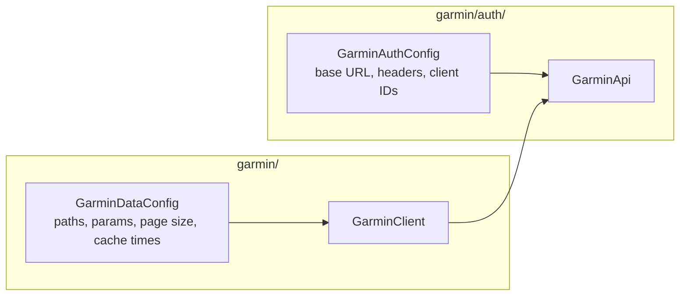
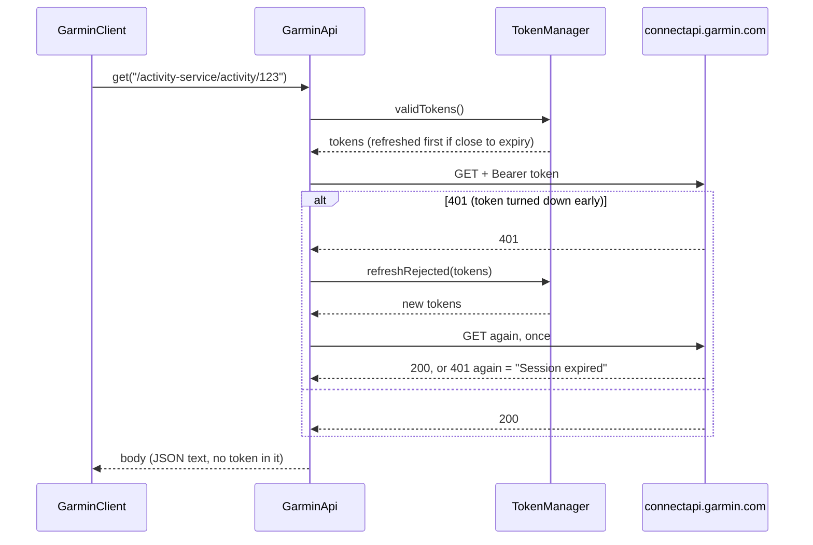
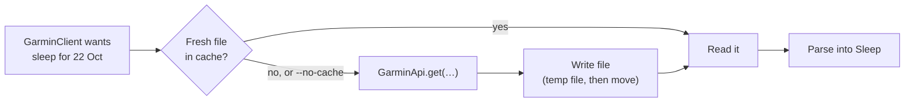

# Phase 2: Fetch real data

**Goal:** read my activities, one activity's details, a daily summary and last night's sleep from Garmin, and keep the results in a cache so we don't ask Garmin twice.

**Done when:** `stride-mcp activities --days 7 --type running` prints last week's runs.

_Status: plan approved 23 October 2026. Step 2 (`GarminApi`) built and tested. Next: the `capture` command._

## The commands

Same jar and same style as phase 1. These are for testing. In phase 3 the same calls become MCP tools.

| Command | What it prints |
|---|---|
| `stride-mcp activities [--days N] [--type T]` | My activities from the last N days (default 7, at most 90), newest first. `--type running` keeps only runs. |
| `stride-mcp activity <id>` | One activity: totals, heart rate, training effect, and each lap. The id is in the `activities` list. |
| `stride-mcp summary [YYYY-MM-DD]` | One day's totals: steps, calories, heart rate, stress, Body Battery. Default today. |
| `stride-mcp sleep [YYYY-MM-DD]` | The night that **ended** on that morning: times, stages, score. Default last night. |
| `stride-mcp capture <folder>` | Saves Garmin's raw replies to files, for building test fixtures. See [Getting real samples](#getting-real-samples). |

| Option | What it does |
|---|---|
| `--no-cache` | Ask Garmin even if the cache has a fresh copy (the new reply is still cached) |
| `--stride.token-file=…` | As in phase 1 |

Example output (made up):

```
$ stride-mcp activities --days 7 --type running
Date        Type           Name             Distance  Time     Pace      Avg HR  Id
Wed 22 Oct  running        Morning Run       8.02 km  42:10    5:15 /km  148     20123456789
Sun 19 Oct  trail_running  Long hill run    15.40 km  1:31:05  5:55 /km  141     20098765432
2 activities.
```

The commands print metric units. The records underneath always use metres and seconds.

## Where each kind of data comes from

_Taken from python-garminconnect's code as of commit `5ddb9ee` (16 October 2026, its "Next Gen" rewrite). Checked 23 October 2026._

All of these are `GET` requests to `https://connectapi.garmin.com`, with the same phone-app headers and `Authorization: Bearer …` as phase 1's profile check.

| Data | Path | Query | Notes |
|---|---|---|---|
| **Who I am** | `/userprofile-service/socialProfile` | | Already used by `whoami`. Gives `displayName`, which the daily endpoints need in their path. |
| **My time zone** | `/userprofile-service/userprofile/personal-information/{displayName}` | | `timeZone`, for example `Europe/London`. See [Dates and time zones](#dates-and-time-zones). |
| **Activities** | `/activitylist-service/activities/search/activities` | `startDate`, `endDate` (YYYY-MM-DD), `start`, `limit`, optional `activityType` | A JSON list, newest first. Paged: `start` is the offset. |
| **One activity** | `/activity-service/activity/{activityId}` | | Totals are inside `summaryDTO`. 404 if the id doesn't exist. |
| **Its laps** | `/activity-service/activity/{activityId}/splits` | | Laps are in `lapDTOs`. |
| **Daily summary** | `/usersummary-service/usersummary/daily/{displayName}` | `calendarDate` (YYYY-MM-DD) | `privacyProtected: true` means Garmin refused. |
| **Sleep** | `/wellness-service/wellness/dailySleepData/{displayName}` | `date` (YYYY-MM-DD), `nonSleepBufferMinutes=60` | Main data in `dailySleepDTO`. |

What python-garminconnect does that we copy (as behaviour, not code):

- `displayName` is URL-encoded before it goes in a path.
- HTTP 204 means "no data", not an error.
- HTTP 404 is "not found", separate from other errors.
- A 401 triggers one refresh and one retry.
- Activities are fetched in pages of 20 until a page comes back empty. We stop earlier: when a page has fewer than 20, it was the last one. We also stop after 10 pages (200 activities) with a clear error, instead of paging forever.

**To confirm with real samples:** the exact field names inside each reply, and whether `activityType=running` also returns trail and treadmill runs.

## Where the paths live

A new record, `GarminDataConfig`, in `com.hammez.stride.garmin`, beside the data client. It holds every path, query parameter name, page size, page limit and cache lifetime from this doc. Nothing else hard-codes them.

The Garmin address itself (`https://connectapi.garmin.com`) and the headers stay in `GarminAuthConfig`, because auth is what sends the requests.



## Signed-in calls without seeing a token

The rule: nothing outside `garmin/auth` touches tokens. So `garmin/auth` gets one new public class, **`GarminApi`**, that sends a request and adds the login itself.

```java
public class GarminApi {
    /** GET a connectapi path. Returns the body ("" for 204). */
    public String get(String path, Map<String, String> query);
}
```

The data client builds the path and query. `GarminApi` gets a valid token from `TokenManager`, adds the headers, sends the request and reads the status.



| Garmin replies | `GarminApi` does |
|---|---|
| 200 | Returns the body |
| 204 | Returns `""`. The client reads that as "no data". |
| 401 | Refreshes **once**, retries **once**. A second 401 is "Session expired. Run `stride-mcp login`." If the token was refreshed a moment ago (it was close to expiry), there is no second refresh: the 401 is "Session expired" straight away. |
| 403 | Stops: "Garmin refused the request… wait a while" (as phase 1) |
| 404 | Throws `NotFoundException`. The client words it, for example "No activity with id 123." |
| 429 | Stops: "Garmin is rate limiting…" (as phase 1) |
| 5xx, anything else | Stops, showing the status and a short, redacted bit of the reply |
| Can't connect, timeout | Stops: "Couldn't reach Garmin…" (as phase 1) |

No other retries, and never two refreshes for one request. Error text goes through `Redactor`, with every access token sent for that request as a known secret.

**Small tidy-ups in `garmin/auth` that come with this:**

- `whoami` moves onto `GarminApi`, so the "refresh once on 401" logic lives in one place. `login` keeps calling `ProfileClient` directly, because its new tokens aren't saved yet.
- Rename `GarminAuthException` to **`GarminException`**. Data errors (404, odd replies) aren't login errors, but the CLI should catch them all in one place. All the existing subclasses stay.
- `GarminApi` refuses a path that isn't plain (no `..`, `?` or `#`, even percent-encoded), so an id or display name can't change which address is called. `GarminApi.segment(…)` encodes those parts. A refused path is a clear error, not a crash.
- Path parts and query values use the same percent-encoding (a space is `%20`). Query parameters are sent in sorted order, so the same request always has the same address.
- The profile check only passes with a JSON profile. An empty reply (204) or a page that isn't JSON is an error, so `login` never saves tokens that weren't shown to work.
- `GarminException` and `NotFoundException` stay in `garmin/auth`, the lowest layer, so `auth` never depends on the layers above it. Higher layers may catch them; they still never see tokens.

## What each call returns

Java records in `com.hammez.stride.garmin`. Only the useful fields, named for a reader, with the unit in the name. A field Garmin leaves out becomes `null`, never `0`.

```java
record ActivitySummary(
        long id,
        String name,
        String type,                     // Garmin's typeKey: "running", "trail_running", "cycling"…
        LocalDateTime startLocal,        // wall-clock time where the activity happened
        Instant start,
        Double distanceMetres,
        Double durationSeconds,
        Double movingDurationSeconds,
        Double elevationGainMetres,
        Double averageSpeedMetresPerSecond,
        Integer averageHeartRateBpm,
        Integer maxHeartRateBpm,
        Integer kilocalories) {}

record ActivityDetails(
        ActivitySummary summary,
        Double maxSpeedMetresPerSecond,
        Double averageCadenceStepsPerMinute,
        Integer averagePowerWatts,
        Double aerobicTrainingEffect,    // 0.0–5.0
        Double anaerobicTrainingEffect,  // 0.0–5.0
        Double trainingLoad,
        List<Lap> laps) {}

record Lap(
        int number,                      // 1, 2, 3…
        Double distanceMetres,
        Double durationSeconds,
        Double averageSpeedMetresPerSecond,
        Integer averageHeartRateBpm,
        Integer maxHeartRateBpm,
        Double elevationGainMetres) {}

record DailySummary(
        LocalDate date,
        Integer steps,
        Integer stepGoal,
        Double distanceMetres,
        Integer totalKilocalories,
        Integer activeKilocalories,
        Integer restingHeartRateBpm,
        Integer minHeartRateBpm,
        Integer maxHeartRateBpm,
        Integer averageStressLevel,      // 0–100
        Integer bodyBatteryHighest,      // 0–100
        Integer bodyBatteryLowest,
        Integer moderateIntensityMinutes,
        Integer vigorousIntensityMinutes,
        Double floorsClimbed) {}

record Sleep(
        LocalDate date,                  // the morning the night ended
        Instant start,
        Instant end,
        Integer sleepSeconds,            // asleep, not counting awake time
        Integer deepSeconds,
        Integer lightSeconds,
        Integer remSeconds,
        Integer awakeSeconds,
        Integer score,                   // 0–100
        String quality,                  // Garmin's label: "EXCELLENT", "GOOD", "FAIR", "POOR"
        Double averageRespirationBreathsPerMinute,
        Double averageSpo2Percent) {}
```

| Method on `GarminClient` | Returns |
|---|---|
| `activities(LocalDate from, LocalDate to, String type)` | `List<ActivitySummary>`, empty if none. `type` may be null. |
| `activity(long id)` | `ActivityDetails`. `NotFoundException` if there's no such activity. |
| `dailySummary(LocalDate date)` | `DailySummary`. Fields are null for a day with no data. |
| `sleep(LocalDate date)` | `Optional<Sleep>`, empty if no sleep was recorded that night |
| `today()` | Today's date in my Garmin time zone |

`summary` includes the day's step total because it's in the same reply. Detailed step data is out of scope.

## Dates and time zones

Garmin's daily endpoints take a plain local date (`2026-10-22`), and Garmin decides what that date means in **the time zone in my Garmin profile**. python-garminconnect added this in October 2026, after "today" kept returning yesterday's data on machines set to UTC.

| Word | Means |
|---|---|
| **Today** | Today's date in my Garmin profile's time zone. If that can't be read, the computer's time zone. |
| **Last N days** | Today and the N−1 days before it. `--days 7` on Thu 23 Oct = Fri 17 Oct to Thu 23 Oct. Not "last calendar week". |
| **Sleep for a date** | The night that ended on that morning. `sleep 2026-10-23` = the night of 22–23 October. So `sleep` with no date = last night. |
| **An activity's time** | `startLocal` is the time on the clock where I did it (from Garmin's `startTimeLocal`). `start` is the exact moment (from `startTimeGMT`). |

The `activities` search filters by start date, in the time zone where each activity happened. _To confirm with real samples._

The profile time zone costs one extra call, so it's cached for a week along with `displayName`.

## Caching

A CLI run is one short process, so a memory-only cache would be empty each time. The cache is **files on disk**, read before every call. In phase 3 the MCP server is a long-running process and can add a memory layer in front of the same files.

`~/.stride-mcp/cache/`, one JSON file per reply, named after what it holds (`activity-20123456789.json`, `sleep-2026-10-22.json`). We cache Garmin's raw reply, not our records, so changing a record doesn't need a cache clear-out.

| What | Kept for | Why |
|---|---|---|
| `displayName` and time zone | 7 days | Almost never change |
| One activity, and its laps | 7 days | Finished activities rarely change (renaming is the usual edit) |
| Activity list, range ends before yesterday | 1 day | Late uploads and edits are possible but rare |
| Activity list, range includes today or yesterday | 10 minutes | A new activity can sync at any time |
| Daily summary or sleep, today or yesterday | 15 minutes | Still changing as the watch syncs |
| Daily summary or sleep, older days | 30 days | Finished |
| An empty reply for an older day | 1 hour | A watch might sync old data late |
| Errors | Never cached | |



| Rule | Why |
|---|---|
| Folder `700`, files `600`, atomic writes, no symlinks (same as the token file) | It's personal data: names, heart rate, GPS start points |
| `logout` deletes the cache too | Logging out should leave no personal data behind |
| Files past their lifetime are deleted when found | Keeps the folder small |
| `--stride.cache-dir=…` moves it | Matches `--stride.token-file` |
| A broken cache file is ignored and replaced | The cache must never be the reason a command fails |

The class is `GarminCache` in `com.hammez.stride.garmin`. It never sees tokens: only replies.

## Getting real samples

I (the agent) mustn't call Garmin with the owner's tokens. So the owner runs one command, which saves Garmin's raw replies, and sends me stripped copies.

```
java -jar target/stride-mcp.jar capture ~/stride-samples
```

It makes about 10 calls, once each, with the cache turned off:

| File | Request |
|---|---|
| `social-profile.json` | `socialProfile` |
| `personal-information.json` | My time zone |
| `activities.json` | Activities for the last 7 days |
| `activities-empty.json` | Activities for 1 to 7 January 2000 (should be empty) |
| `activity.json`, `activity-splits.json` | The newest activity in that list, and its laps |
| `activity-not-found.json` | Activity id `1` (should be 404) |
| `summary-today.json`, `summary-past.json` | Today, and 30 days ago |
| `sleep-last-night.json`, `sleep-none.json` | Last night, and 1 January 2000 (should have no sleep) |

Each file holds the status code and the reply body, never headers, never tokens. The folder is created `700`, the files `600`. It prints a reminder that the files contain personal data.

**Before sending them, remove or replace** (any value is fine, as long as the field stays):

| Look for | Example fields |
|---|---|
| Names and ids | `displayName`, `fullName`, `userName`, `ownerFullName`, `ownerDisplayName`, `userProfileId`, `userProfilePK`, `ownerId`, `profileId` |
| Places | `startLatitude`, `startLongitude`, `endLatitude`, `endLongitude`, `locationName`, any polyline |
| Pictures | anything ending `ImageUrl…` |
| Devices | `deviceId`, serial numbers |
| Anything else that looks personal | birth date, email, activity names you'd rather not share |

I then turn them into fixtures under `src/test/resources/garmin/`, plus made-up variants (missing fields, odd values) for the failure tests.

## Errors I should see

| Situation | Message (roughly) |
|---|---|
| Not logged in, session expired, 403, 429, can't connect | Same as phase 1 |
| `activity` id doesn't exist | "No activity with id 123. Check the id in `stride-mcp activities`." |
| `activity` id isn't a number | "Activity ids are numbers, like 20123456789." (exit code 2) |
| Bad date | "Dates look like 2026-10-22." (exit code 2) |
| `--days` out of range | "--days must be between 1 and 90." (exit code 2) |
| Too many activities in the range | "More than 200 activities in that range. Try fewer --days." |
| Daily summary has `privacyProtected` | "Garmin wouldn't share this day's summary. Run `stride-mcp login` again." |
| A reply isn't the shape we expect | "Garmin's reply for … wasn't what stride-mcp expected. Garmin may have changed it. Check for an update." |
| No sleep that night | Not an error: "No sleep recorded for the night ending Thu 23 Oct." |
| No activities in the range | Not an error: "No activities in the last 7 days." |

## Code layout

```
com.hammez.stride
├── cli/              + activities, activity, summary, sleep, capture
├── garmin/
│   ├── GarminClient       the four calls, cache first, then GarminApi
│   ├── GarminDataConfig   paths, params, page size, cache times
│   ├── GarminCache        reply files under ~/.stride-mcp/cache
│   ├── GarminSamples      the capture command's calls
│   └── ActivitySummary, ActivityDetails, Lap, DailySummary, Sleep
└── garmin/auth/
    ├── GarminApi          NEW: signed-in GET, refresh once on 401
    └── NotFoundException  NEW: HTTP 404
```

**No new libraries.** The JDK's HTTP client, Jackson 3 (already in Spring Boot) and the JDK's `java.time`.

## Tests

Against `FakeGarmin`, extended to match query strings and to serve fixture files. No real Garmin calls.

| Area | Cases |
|---|---|
| `GarminApi` | 200, 204, 401 then refresh then 200, 401 twice = session expired, 403, 404, 429, 500, redaction of error text, token never in a message |
| Activities | Normal list, empty list, missing fields become null, paging (20 then 3), page limit hit, `--type` filter sent |
| One activity | Normal, no laps, 404 |
| Summary | Normal, all-null day, `privacyProtected` |
| Sleep | Normal, no sleep (empty `dailySleepDTO`), 204 |
| Dates | Profile time zone used for "today", fallback to computer's zone, `--days 7` range |
| Cache | Fresh hit makes no request, stale entry refetched, `--no-cache`, broken file ignored, file permissions, `logout` clears it |
| CLI | Output for each command, bad id, bad date, bad `--days` |

## Steps

1. ✅ **Plan:** this doc. Approved 23 October 2026.
2. ✅ **`GarminApi`** in `garmin/auth`, with `whoami` moved onto it, and the exception rename. Tests.
3. **`capture` command.** Then the owner runs it and sends stripped samples.
4. **Records and `GarminClient`**, parsed against fixtures made from the samples. Tests.
5. **`GarminCache`**. Tests.
6. **CLI commands** `activities`, `activity`, `summary`, `sleep`. Tests.
7. **Docs:** quick start, this doc, AGENTS.md status.
8. **Live check** (owner): run each command, then run them again and see the cache answer.

## Not in phase 2

- The MCP server and tools (phase 3)
- Steps detail, weight and body composition, HRV, training status, stress and Body Battery detail (phase 4)
- Writing anything to Garmin
- GPS tracks, charts, second-by-second data, FIT/GPX downloads
- Retries, or spreading out requests (phase 4)
- Imperial units in the output
- Garmin China accounts

## Decisions (approved 23 October 2026)

| Question | Proposal |
|---|---|
| Exception name | Rename `GarminAuthException` to `GarminException` |
| Time zone | Use the Garmin profile's, cached for a week. Fall back to the computer's. |
| Samples | A `capture` command, built before the parsing, so fixtures come from real replies |
| Activity details | Summary plus laps (2 calls). No GPS or charts. |
| Cache | Raw replies on disk, lifetimes as in the table above |

## Credit

Endpoints and their behaviour are based on [python-garminconnect](https://github.com/cyberjunky/python-garminconnect) (MIT licence). We rewrite them in Java rather than copying code.
