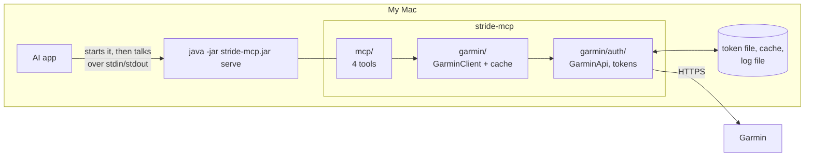

# Phase 3: MCP server (stdio)

**Goal:** an AI app on my Mac (Claude Code, Claude Desktop, Codex CLI) starts stride-mcp and calls four tools to read my activities, one activity, a daily summary and sleep.

**Done when:** I ask Claude "how was my training this week?" and get an answer built from my real Garmin data.

_Status: plan approved 25 October 2026, with all the proposed decisions. Next: step 2, dependencies and `serve`._

## What changes

Same jar. Phase 2's commands stay as they are. One new command, `serve`, starts the MCP server.



The tools only call `GarminClient`. They never see `GarminApi` or tokens (the layer rule in AGENTS.md).

## The library (checked 24 October 2026)

| Thing | Version | Notes |
|---|---|---|
| Spring AI | **2.0.2** (current stable) | Its MCP server starter is built against Spring Boot **4.1.2**. We're on 4.1.1, so we move up one patch release. |
| Spring AI 2.1.0 | RC1 only | Built against Spring Boot 4.2.0-RC1. Not for us yet. |
| Starter | `spring-ai-starter-mcp-server` | The stdio one. "No additional web dependencies" (Spring AI docs). |
| MCP Java SDK | 2.1.0, brought in by Spring AI | Uses Jackson 3 (`mcp-json-jackson3`), like the rest of the app. Also brings Reactor, and Spring AI's model module. |

Checked against the poms on Maven Central and the Spring AI 2.0.2 reference docs.

**New dependencies, and why:** the Spring AI BOM (2.0.2) and `spring-ai-starter-mcp-server`. The project plan already chose Spring AI for the MCP server. Writing the MCP protocol ourselves would be more code to keep up with a spec that changes often.

**Dependencies to drop:** `spring-boot-starter-webmvc` and `spring-boot-starter-actuator`, with their test starters. Nothing uses them (`web-application-type=none` since phase 1). Fewer libraries means a faster start, and the AI app starts the jar each session. Phase 5 (hosted) adds a web starter back.

## Two modes, one jar

```
java -jar stride-mcp.jar serve
```

| | CLI commands (`login`, `activities`…) | `serve` |
|---|---|---|
| MCP server | Off | On, over stdio |
| stdin | My paste at `login` | MCP messages from the AI app |
| stdout | The command's output | **MCP messages only** |
| Logs | Warnings only, to the console as now | To a file, never the console |
| Ends | After the command, with its exit code | When the AI app closes stdin |

`main` decides the mode before Spring starts: `serve` turns on a Spring profile, also called `serve`. Without it, the MCP server is off. This matters: the server reads stdin, and so does `login`.

`main` today exits as soon as Spring has started. In `serve` mode it waits until the transport closes, then exits `0`.

**Keeping stdout clean.** In `serve` mode:

- No banner (already off), no startup info (already off), console logging off.
- Logs go to `~/.stride-mcp/stride-mcp.log`. That folder is already `700`. Warnings and errors only, plus one line per tool call (tool name, how long it took, whether it worked). Never tokens, never Garmin's replies.
- Belt and braces: the server keeps the real stdout for itself, then points `System.out` at stderr. So a stray `println` anywhere can't break the connection. AI apps keep a server's stderr as its log.

`serve` takes no options except the Spring settings (`--stride.token-file=…`, `--stride.cache-dir=…`). `whoami`, `capture` and the others don't change.

### To confirm in step 2

Things the docs don't say clearly, settled by the first build with a test:

| Question | Plan if the answer is no |
|---|---|
| `spring.ai.mcp.server.enabled=false` turns the server off for CLI commands | Exclude the auto-configuration outside `serve` |
| The stdio transport needs `spring.ai.mcp.server.stdio=true` with this starter | Set it either way, in the `serve` profile |
| Our own transport bean (with the stdout we kept) replaces the default one | Redirect `System.out` before Spring starts, keeping the real stream for the transport |
| `spring.ai.mcp.server.instructions` sets the server's instructions for the AI | Put the same text in each tool's description |
| A `RuntimeException` from a tool becomes an error result the AI sees (as the docs say) | Catch `GarminException` in the tools and build the error result ourselves |

## The tools

Four tools, as in the project plan. All read-only. The names are the ones the AI sees.

| Tool | Inputs | Returns |
|---|---|---|
| `get_activities` | `from`, `to` (dates, optional), `type` (optional), `refresh` (optional) | Activities that started in that range, newest first |
| `get_activity` | `id` (required), `refresh` | One activity: totals, heart rate, cadence, power, training effect and laps |
| `get_daily_summary` | `date` (optional), `refresh` | One day's steps, calories, heart rate, stress, Body Battery, intensity minutes, floors |
| `get_sleep` | `date` (optional), `refresh` | The night that ended on that morning: times, stages, score, breathing, SpO2 |

| Input | Means |
|---|---|
| A date | `YYYY-MM-DD`, in the owner's Garmin profile time zone |
| `from`, `to` | Both included. Default: the last 7 days, today included. At most 90 days. |
| `date` | Default today. For `get_sleep`, today means last night. |
| `type` | Garmin's type key: `running`, `cycling`, `strength_training`… Leave out for all types. |
| `id` | A number from `get_activities` |
| `refresh` | `true` to ask Garmin even if a recent copy is cached. Same as `--no-cache`. |

Each tool is marked read-only and not destructive, with MCP's tool hints (`readOnlyHint`, `destructiveHint`).

### What the AI reads

The AI reads the descriptions to choose a tool. So they say what comes back, what the inputs mean (with formats and units) and when to use the tool. Drafts:

> **get_activities**: Lists the owner's Garmin Connect activities (runs, rides, strength sessions, walks and others) that started between two dates, newest first. For each: id, name, type, local start time, distance in km, time, moving time, average pace per km, elevation gain in metres, average and max heart rate in bpm, and calories. Use it for questions about training over a period, such as "how was my training this week?" or "how far did I run in September?". Then use get_activity with an id for laps, cadence, power and training effect. `from` and `to` are dates like 2026-10-22, both included, at most 90 days apart. Leave both out for the last 7 days. The reply also gives today's date in the owner's time zone.

> **get_activity**: One Garmin activity in detail: start time, type, distance, time and moving time, pace and fastest pace, elevation gain, heart rate, cadence, power, calories, aerobic and anaerobic training effect (0 to 5), training load, and each lap's distance, time, pace, heart rate and elevation. Fields Garmin didn't record are left out. `id` is a number from get_activities.

> **get_daily_summary**: The owner's totals for one day from Garmin: steps and step goal, distance, calories (total and active), resting, minimum and maximum heart rate, average stress (0 to 100), lowest and highest Body Battery (0 to 100), moderate and vigorous intensity minutes, and floors climbed. `date` is like 2026-10-22, in the owner's time zone. Leave it out for today. Today's numbers grow as the watch syncs.

> **get_sleep**: The owner's sleep for the night that ended on the morning of `date`: when it started and ended, time asleep, deep, light and REM sleep, time awake, the sleep score (0 to 100) with Garmin's label, average breathing rate and average SpO2. `date` is like 2026-10-23, which means the night of 22 to 23 October. Leave it out for last night.

`refresh` is described the same way in each tool: "Only set this when the owner says data is missing or they just synced their watch. Replies are already kept fresh for 10 to 15 minutes for today and yesterday."

Server instructions (if step 2 confirms they work): "Garmin data for the owner of this computer. Dates are in the owner's Garmin profile time zone. Units are metric. If a tool says to run `stride-mcp login`, tell the owner to run it in a terminal: this server can't log in by itself."

### What comes back

JSON as text. Every MCP app reads text, so this works with any of them (the AGENTS.md rule). Structured output (an output schema) is left out for now: AI apps don't all support it yet (October 2026).

The JSON is shaped for an AI reader, not copied from the records:

| Rule | Why |
|---|---|
| Distances in km, elevation in metres | What people ask in. Saves the AI converting from metres. |
| Times both ways: `"duration": "36:01"` and `"durationSeconds": 2161` | The text to quote, the number to add up |
| Pace as text: `"pace": "7:08 /km"` | Turning metres per second into pace is easy to get wrong |
| Start as local time: `"start": "2026-10-22T07:06"` | The time on the clock where it happened, as in the CLI |
| Missing values left out, not `null` | Less noise. The description says fields may be missing. |
| Each reply says `today` and `timeZone` | An AI often doesn't know today's date, or whose "today" it is |
| No data is not an error | An empty list, or `"recorded": false` for sleep and daily summary |

For example (the shape, not final; numbers from the live check of 24 October 2026):

```json
{
  "today": "2026-10-24",
  "timeZone": "Europe/London",
  "from": "2026-10-18",
  "to": "2026-10-24",
  "type": "running",
  "count": 3,
  "activities": [
    {
      "id": 24810777073,
      "name": "Islington Running",
      "type": "running",
      "start": "2026-10-22T07:06",
      "distanceKm": 5.05,
      "duration": "36:01",
      "durationSeconds": 2161,
      "movingDuration": "35:51",
      "pace": "7:08 /km",
      "elevationGainMetres": 18,
      "averageHeartRateBpm": 143,
      "maxHeartRateBpm": 169,
      "kilocalories": 448
    }
  ]
}
```

These reply records live in `mcp/`. The Garmin records from phase 2 don't change.

### Garmin's `0` for missing values

As in the CLI: Garmin sends `0` for the distance, speed and moving time of activities without them (strength training, indoor cycling). The tools leave those out, so the AI doesn't read "0 km" as a value.

## Errors

The AI sees an error result with a message. It usually passes it on to me. Phase 2's messages already say what to do next, so the tools reuse them.

| Situation | The AI sees |
|---|---|
| Not logged in, session expired | "Not logged in. Run `stride-mcp login`." The server can't log in itself: the browser sign-in and paste need a terminal. After a login in the terminal, the next tool call works, with no restart. (Tokens are read from the file on each call.) |
| 403, 429 | Phase 1's "wait a while" messages. The description doesn't invite retries. stride-mcp never retries these. |
| Bad date, `from` after `to`, more than 90 days, unknown input | "Dates look like 2026-10-22.", "The range can be at most 90 days." Nothing is sent to Garmin. |
| No activity with that id | "No activity with id 123. Check the id with get_activities." |
| Garmin wouldn't share the summary, reply not as expected, more than 200 activities | Phase 2's messages |
| Anything else (a bug) | "stride-mcp hit an unexpected error. Details are in ~/.stride-mcp/stride-mcp.log." The details go to the log, never to the AI. |

A few phase 2 messages mention CLI commands, for example "Check the id in `stride-mcp activities`". The tools word those for the AI instead. Messages that say "Run `stride-mcp login`" stay as they are: that's what I'd do in either case.

## A process that keeps running

The CLI runs for a second. The server runs as long as the AI app does. What that changes:

| Thing | Choice |
|---|---|
| "Today" | Worked out on each call (already: `GarminClient.today()` reads the clock each time) |
| Tokens | Loaded, refreshed and saved under the token file's lock on each call (already). The CLI and the server can run at once. |
| Cache | Disk files, read on each call, as in phase 2. No memory cache yet: the files are small and local. Phase 4 adds one if it's needed. |
| `displayName` and time zone | Remembered in memory for 7 days, as in phase 2 |
| Switching Garmin account | `logout`, `login`, then restart the AI app, so the server forgets the old account's `displayName` |
| Two tool calls at once | Possible. `GarminClient`'s memory is an `AtomicReference`, the token store is locked, and cache writes are atomic. A test runs calls side by side to be sure. |

## Shared rules, one place

The CLI and the tools check the same things. Neither layer may depend on the other, so the shared parts move down into `garmin/`:

- The 90-day limit moves from `cli/CommandLine` to `GarminDataConfig`.
- Each layer still reads its own input: `--days 7` on the command line, `from` and `to` in the tools.

## Code layout

```
com.hammez.stride
├── StrideMcpApplication   picks CLI or serve mode, waits for the server in serve mode
├── cli/                   unchanged, except: no MCP server outside serve, 90-day limit from GarminDataConfig
├── mcp/
│   ├── GarminTools        the four tools: inputs checked, then GarminClient
│   ├── ToolReplies        records into the JSON shapes above (km, pace, local times)
│   ├── ActivitiesReply, ActivityReply, DayReply, SleepReply
│   └── McpBeans           serve mode: the transport, stdout kept for it, server name and instructions
├── garmin/                unchanged, plus the 90-day limit in GarminDataConfig
└── garmin/auth/           unchanged
src/main/resources/
├── application.properties         + MCP server off
└── application-serve.properties   MCP server on (stdio), console logging off, log file
```

## Tests

Against `FakeGarmin` and the phase 2 fixtures, as before. No real Garmin calls.

| Area | Cases |
|---|---|
| Tools | Each tool's JSON from the fixtures (pinned, like `DataPrinterTest`). Defaults: last 7 days, today, last night. `type` and `refresh` passed on. Garmin's `0`s and missing values left out. `today` and `timeZone` in each reply. |
| Inputs | Bad date, `from` after `to`, 91 days, missing `id`. Each one an error, with nothing sent to Garmin. |
| Errors | Not logged in, session expired, 404, 429, `privacyProtected`, unexpected reply, an unexpected bug (message points to the log, with no details). No token in any reply or log line. |
| Server over stdio | Start the server with piped streams, send `initialize`, `tools/list` and `tools/call`. Check the four tools, their descriptions and hints, and a real reply. **Every line on stdout is a JSON-RPC message.** A `println` from a tool doesn't reach stdout. |
| Modes | CLI commands don't start the MCP server, and `login` still reads the paste. `serve` ends when stdin closes. |
| Side by side | Several tool calls at once give the same answers as one at a time |

## What I should see

At the live check:

| I do | I should see |
|---|---|
| Ask before logging in | The AI says to run `stride-mcp login` in a terminal |
| Log in, ask again | A real answer, with no restart |
| Ask twice within 10 minutes | The second answer comes from the cache (no new files in the cache folder) |
| Say "I just synced, check again" | The AI calls with `refresh: true` |

## Steps

1. ✅ **Plan:** this doc. Drafted 24 October 2026, approved 25 October 2026.
2. **Dependencies and `serve`:** Spring Boot 4.1.2, Spring AI 2.0.2, webmvc and actuator dropped. `serve` mode with the server off elsewhere, stdout kept clean, logs to a file, waits until stdin closes. Settle [To confirm in step 2](#to-confirm-in-step-2). Tests: a server with no tools answers `initialize` and `tools/list`, and stdout carries only JSON-RPC.
3. **Shared rules:** the 90-day limit into `GarminDataConfig`. Tests.
4. **The tools and their replies** in `mcp/`, with descriptions. Tests against the fixtures.
5. **Errors** as tool errors, with CLI wording replaced where needed. Tests for each row of [Errors](#errors).
6. **End to end over stdio:** the piped-stream test, and the side-by-side test.
7. **Docs:** [Running it](../running.md) gets the `serve` command. The quick start gets a short "Use it from an AI app" section. AGENTS.md status.
8. **Live check** (owner): add stride-mcp to Claude Code (`claude mcp add stride -- java -jar …/stride-mcp.jar serve`), ask "how was my training this week?", then the questions in [What I should see](#what-i-should-see). Then the same in Codex CLI, since it must work with any MCP app.

## Not in phase 3

- Local HTTP or hosted (phase 5)
- New kinds of data: steps detail, weight, HRV, training status (phase 4)
- Prompts or resources, such as a "weekly review" prompt (later, maybe)
- Structured output schemas (when AI apps support them more widely)
- A memory cache in front of the files (phase 4, if needed)
- Retries, or spreading out requests (phase 4)
- Writing anything to Garmin

## Decisions (approved 25 October 2026)

| Question | Decision | Other option |
|---|---|---|
| Command name | `serve` (`stride-mcp serve` reads well) | `mcp` |
| Spring AI version | 2.0.2, with Spring Boot 4.1.2 | Wait for 2.1.0 and Boot 4.2 |
| Unused web and actuator starters | Drop them now | Keep them until phase 5 |
| Activities input | `from` and `to` dates (the AI often has dates in mind) | `days`, as in the CLI |
| Reply format | JSON as text, shaped for the AI (km, pace, both kinds of time) | The CLI's printed text, or the raw records |
| `refresh` input | Yes, described so the AI uses it only when asked | No: the cache lifetimes are short enough |
| Log file | `~/.stride-mcp/stride-mcp.log`, inside the `700` folder | A `logs/` folder of its own |

## Credit

Spring AI's MCP server starter and the MCP Java SDK do the protocol work. Versions and settings are from Maven Central and the Spring AI 2.0.2 reference docs, checked 24 October 2026.
