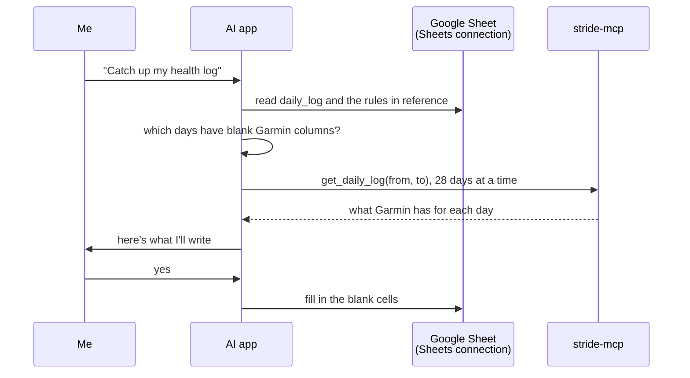

# Phase 4c: Catch up the health log

**Done when:** I say "catch up my health log". The AI finds the days whose Garmin columns are blank, shows me what it will write, and fills them in once I say yes. It never touches the columns I fill in myself.

_Status: plan approved 20 November 2026, with all the [decisions](#decisions-to-make). The owner chose where the rules live, the activity names and the sleep night (✅), and approved the rest as proposed. Starts after [4a](phase-4a-weight.md) and [4b](phase-4b-daily-log.md)._

## Who does what

stride-mcp never touches the spreadsheet. The AI app reads and writes it through its own Google Sheets connection, and asks stride-mcp for the Garmin side. I mostly use **Codex** for this, because its Sheets connection works better for me (20 November 2026). Nothing here relies on one app, though.

Why stride-mcp doesn't write the sheet:
- It would need a Google login as well as a Garmin one.
- It keeps stride-mcp about Garmin, and usable with any log.
- The AI app already asks before it writes, and shows me what changed.

## Where the rules live

The AI needs the sheet's rules: which Garmin type counts as `Gym?`, what goes in `Exercise Mins`, and so on. Three places they could go:

| Where | Good | Not so good |
|---|---|---|
| **A "Garmin columns" section in the sheet's `reference` tab** (✅ owner's choice) | Any AI app that can read the sheet finds it. It sits next to the sheet's other rules (the sleep and alcohol scales are already there). One place to change. | The AI has to be told to read it. A sentence in the request, or in the tool description, does that. |
| An MCP prompt in stride-mcp, such as `catch_up_log` | Comes with the server. Claude Code shows it as a slash command. | Puts one spreadsheet's rules, and its address, into stride-mcp. Not every AI app shows MCP prompts (Codex: to check). |
| The Claude skill `health-daily-entry` | Already used for the morning check-in | Claude only. Today it writes `health_log.xlsx`, which the `reference` tab calls an archive. |

Chosen 20 November 2026: the `reference` tab. The skill could then be changed to read it, if I keep using the skill (a decision for later, outside this repo).

## The rules (draft, for the `reference` tab)

From `get_daily_log`'s reply ([4b](phase-4b-daily-log.md)) to the columns:

| Column | Rule |
|---|---|
| Sleep Score | `sleep.score` |
| Sleep Hrs | `sleep.hours`, 1 decimal place |
| Sleep (1-3), Sleep | From the score, as the `reference` tab already says: 80+ is 3 Good, 60 to 79 is 2 OK, under 60 is 1 Bad |
| Activities | Each activity's `type`, named as below (not the activity's own `name`, such as "London Running"), joined with ", ", in the order they started. A day with none is "None", with Sessions, Run?, Gym? and Football? 0 and Exercise Mins 0.0, as the log already does. Never left blank, or the day would look unfinished. |
| Sessions | How many activities |
| Run? | 1 if any activity's `group` is `running`, otherwise 0 |
| Gym? | 1 if any is `strength_training`, otherwise 0 |
| Football? | 1 if any is `soccer`, otherwise 0 (Garmin's word, to check) |
| Exercise Mins | All the activities' `minutes` added up, except walks, 1 decimal place. (The `reference` tab says walking counts in Steps, not here. Hikes count.) |
| Steps | `steps` |
| Weight (kg), Body Fat %, Muscle (kg) | `weight.kg`, `weight.bodyFatPercent`, `weight.muscleMassKg` |
| Fat Mass (kg) | Weight × Body Fat % ÷ 100, 1 decimal place. Only when both are there. |

Activity names. The log has used two sets. From now on it uses Garmin's names, as it has since October 2026 (owner's choice, 20 November 2026). Older rows keep Run, Gym and Hike.

Garmin's reply gives a type key, not the name the Garmin Connect app shows, so the rule is the key with the underscores taken out and each word capitalised (`indoor_cycling` is "Indoor Cycling"). These keys break that rule:

| Garmin type | Name in the log |
|---|---|
| `strength_training` | Strength |
| `soccer` | Soccer/Football |
| `stair_climbing` | Stair Stepper |

So `running` is "Running", `treadmill_running` is "Treadmill Running", and `hiking` is "Hiking". `Run?` still covers all of them, through `group`.

## How a catch-up works

1. Read `daily_log` and the rules.
2. Find the days up to yesterday where **any** of Sleep Score, Steps or Activities is blank. So a day filled in halfway still gets finished. A blank weight is normal (no weigh-in), so it doesn't count, but it's filled in if Garmin has one. Today is never logged: it isn't over.
3. Find each day's row **by its date, not its position**. Rows aren't always in order (see below).
4. Ask `get_daily_log` for those days, oldest first, 28 days a call.
5. Show me a table: each day, and each cell it will fill.
6. On my yes, fill in **blank cells only**. A cell that already has a different value is listed, not changed. It may be something I typed in.
7. A day with no row gets a new row at the bottom, as the `reference` tab says, with the date columns filled in too.
8. Never write the columns Garmin doesn't supply.

How far back: from the last day with its Garmin columns filled in. At most 90 days unless I ask for more, to be gentle with Garmin.

### Every day

Most days this isn't a catch-up at all: I log one day, every morning, for the day before ("log yesterday"; owner, 20 November 2026). By then yesterday's steps and activities have synced, and the night that ended yesterday morning has its sleep score. So today is never logged, and nothing has to be filled in later. That's the same steps for one day: one `get_daily_log` call, which defaults to yesterday, and a preview of one row. A catch-up is just what happens after I've missed a few days, so there's only one set of rules to get right.

## Found in the sheet (20 November 2026)

What a catch-up has to cope with:

| Found | What the catch-up does |
|---|---|
| Garmin columns blank on 8 to 11, 13 to 18 and 20 November. Sleep and steps are there on 12 and 19 November. | Fills these in: the first real catch-up |
| No weight since 2 November | Fills it in where Garmin has a weigh-in |
| Rows out of order: 21 Oct after 23 Oct, 31 Oct after 1 Nov, 11 Nov after 13 Nov | Finds rows by date |
| Rows for 21 to 24 November with only the date | Uses them, once the day is over |
| 31 Oct and 1 Nov have only mood and alcohol | Fills in their Garmin columns |
| Two names for the same activity (Gym and Strength, Run and Running) | Uses Garmin's names (Running, Strength) from now on. The old rows stay as they are (owner's choice). |
| `Gym?` is 0 on some Strength days (9, 12, 13, 19 and 26 to 28 October) and blank on 14 October | Leaves them alone (they aren't blank days). The same separate decision as above. |
| Fat Mass blank on some days with a weight (24 and 29 September, 1 to 3 October) | Leaves them alone. A clean-up could fill them. |

## Decisions to make

| Question | Proposed |
|---|---|
| Where the rules live | ✅ The sheet's `reference` tab (owner's choice, 20 November 2026) |
| Activity names | ✅ Garmin's names (Running, Strength and the others above) from now on. The old rows stay as they are (owner's choice, 20 November 2026). |
| Which night goes with a date | ✅ The night that ended that morning (owner confirmed, 20 November 2026) |
| Overwrite filled cells? | Never. List the ones that differ. |
| Default reach | From the last fully filled day, at most 90 days |
| Tidy the old rows (`Gym?`, Fat Mass)? | A separate, one-off clean-up, if I want it. Not part of the catch-up. (The names stay as they are.) |

## Steps

1. **Plan:** this doc.
2. **Rules:** once I approve them, add the "Garmin columns" section to the `reference` tab (through the Sheets connection, with my OK).
3. **Tool description:** `get_daily_log`'s description says that a log's own rules decide how its columns are filled, so the AI looks for them.
4. **First catch-up** (owner, watching): 31 October to 20 November **in Codex**, the app I'll use every day. Check the preview against the Garmin Connect app before saying yes.
5. **A normal day** (owner): "log yesterday" in Codex the next morning. One tool call, one row.
6. **Docs:** a short "Fill in a spreadsheet" section in the quick start, with the Codex setup. AGENTS.md status.
7. **Try it in Claude Code** (owner): one day, to show it doesn't rely on Codex.

No Java changes beyond 4b, apart from the tool description.

## Not in this plan

- stride-mcp writing to Google Sheets, or any spreadsheet
- Running a catch-up on a timer. That could be a scheduled AI task later.
- The manual columns (mood, alcohol and the rest), and the morning check-in that asks for them
