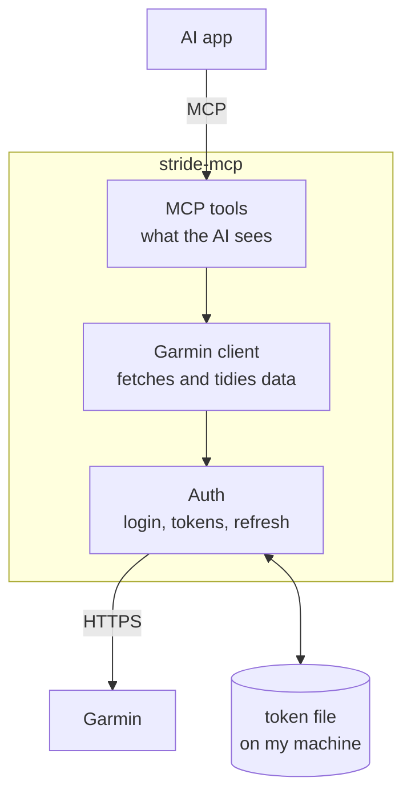

# Project plan

## What we're building

One Spring Boot app with three layers.

**It must work with any AI app that supports MCP** (Claude, ChatGPT and others), so it never relies on features only one AI app has.

| Layer | Job | Why it's separate |
|---|---|---|
| **Auth** | Log in once, save tokens, refresh them | The fragile part. When Garmin changes something, we fix it here only. |
| **Garmin client** | Call Garmin's endpoints, turn raw responses into clean Java objects | Keeps Garmin's messy data shapes away from the tools |
| **MCP tools** | Small, well-described tools for the AI | This is what the AI sees. Keep it simple and readable. |

## Phases

### Phase 1: Log in from the command line
Detailed plan: [Phase 1](phases/phase-1-login.md)
- `stride-mcp login`: I log in on Garmin's page in my browser and paste back the address. Tokens are saved.
- `stride-mcp whoami`: checks the saved tokens still work
- **Done when:** I can log in once and `whoami` still works days later.

### Phase 2: Fetch real data
Detailed plan: [Phase 2](phases/phase-2-data.md)
- Recent activities, one activity's details, daily summary, sleep
- Simple caching so we don't hit Garmin repeatedly
- **Done when:** a small command prints last week's runs.

### Phase 3: MCP server (stdio)
Detailed plan: [Phase 3](phases/phase-3-mcp.md)
- Add Spring AI's MCP server
- First tools: `get_activities`, `get_activity`, `get_daily_summary`, `get_sleep`
- Connect it to Claude Desktop or Claude Code
- **Done when:** I can ask Claude "how was my training this week?" and get a real answer.

### Phase 4: Make it reliable
- Clear error messages, especially "please log in again"
- Retries, rate limiting and tests
- More tools: steps, weight and body composition history, training status, HRV. (The CLI `summary` shows the day's weight and body composition since 25 October 2026.)

### Phase 5: Hosted online (needed for ChatGPT)
- Streamable HTTP transport
- Hosting, plus proper login (OAuth) so only I can use it
- See [Running it](running.md) for why ChatGPT needs this

### Later, maybe
- Writing to Garmin (creating workouts)
- Summary prompts ("weekly review")
- Importing a Garmin data export as an offline backup
- Storing tokens in the macOS Keychain

## Decisions

| Question | Decision |
|---|---|
| Which AI apps? | Any app that supports MCP, including Claude and ChatGPT |
| Login: Java or Python helper? | Write it ourselves in Java |
| Login: password prompt or browser? | Browser. Garmin blocks password logins from Java clients (October 2026). |
| Where do tokens live? | A private file in my home folder. Keychain later, maybe. |
| Which data first? | Eventually sleep, steps, all activity data and weight. Start with whichever is easiest. |
