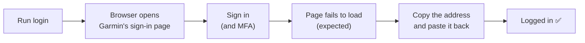

# Quick start

Log in to Garmin and check it works. Takes about five minutes.

_Written October 2026. Phase 1 only: stride-mcp can log in and stay logged in. It can't fetch your data or talk to an AI app yet._

## You need

- **Java 25** (`java -version` to check)
- A **Garmin Connect** account
- A Mac works best: stride-mcp opens your browser for you. On other systems, you copy the address yourself.

## 1. Build it

```
cd ~/Development/source/stride-mcp
./mvnw package
```

This makes `target/stride-mcp.jar`. Optional shortcut, so the commands below work as written:

```
alias stride-mcp='java -jar ~/Development/source/stride-mcp/target/stride-mcp.jar'
```

## 2. Log in

```
stride-mcp login
```



1. Your browser opens Garmin's sign-in page. Sign in as normal.
2. The browser then **fails to load a page**. That's expected. If it warns the connection isn't secure, **don't click Continue**.
3. Copy the **whole address** from the address bar. It contains `ticket=ST-…`.
4. Paste it into the terminal and press Enter.

You'll see something like:

```
Logged in as Jo Runner.
Tokens saved to /Users/you/.stride-mcp/garmin_tokens.json
Access token valid until Sat 24 Oct 2026, 05:12 (refreshed automatically).
Session valid until Sun 22 Nov 2026, 08:12. Use stride-mcp before then to keep it going.
```

stride-mcp never sees your password. It only gets a one-time ticket from that address.

## 3. Check it

```
stride-mcp whoami
```

This prints who you're logged in as. It refreshes the login by itself when needed.

**Use stride-mcp at least once every 30 days** and you shouldn't need to log in again.

## 4. Log out (optional)

```
stride-mcp logout
```

This deletes the saved login.

## If something goes wrong

| You see | Do this |
|---|---|
| "No ticket found" | Copy the **full** address from the address bar, not the page text |
| "Garmin didn't accept that ticket" | Tickets work once. Run `login` again. |
| "Garmin is rate limiting" / "HTTP 403" | Wait an hour or more. Don't keep retrying. |
| "Not logged in" | Run `stride-mcp login` |
| "Session expired" | Run `stride-mcp login` |
| "app IDs may have changed" | Garmin changed its login. Check for an update to stride-mcp. |
| "Token file … is unreadable" | Run `stride-mcp logout`, then `stride-mcp login` |

## Good to know

- Your login is saved in `~/.stride-mcp/garmin_tokens.json`, readable only by you. Treat it like a password.
- Use `--stride.token-file=/some/path.json` to save it somewhere else.
- Exit codes: `0` worked, `1` failed, `2` wrong usage.

## Next

- How the login works, in detail: [Phase 1: Login](phases/phase-1-login.md)
- What's coming (data, then AI apps): [Project plan](project-plan.md)
