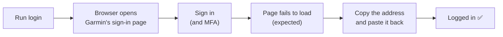

# Quick start

Log in to Garmin, check it works, and read your data. Takes about five minutes.

_Written October 2026. stride-mcp can now log in and read your activities, daily summary and sleep on the command line. It can't talk to an AI app yet: that's phase 3._

## You need

- **Java 25** (`java -version` to check)
- A **Garmin Connect** account
- A Mac works best: stride-mcp opens your browser for you. On other systems, you copy the address yourself.

## 1. Build it

```
cd ~/Development/source/stride-mcp
./mvnw package
```

This makes `target/stride-mcp.jar`. Optional shortcut, so the commands below work as written:

```
alias stride-mcp='java -jar ~/Development/source/stride-mcp/target/stride-mcp.jar'
```

## 2. Log in

```
stride-mcp login
```



1. Your browser opens Garmin's sign-in page. Sign in as normal.
2. The browser then **fails to load a page**. That's expected. If it warns the connection isn't secure, **don't click Continue**.
3. Copy the **whole address** from the address bar. It contains `ticket=ST-…`.
4. Paste it into the terminal and press Enter.

You'll see something like:

```
Logged in as Jo Runner.
Tokens saved to /Users/you/.stride-mcp/garmin_tokens.json
Access token valid until Sat 24 Oct 2026, 05:12 (refreshed automatically).
Session valid until Sun 22 Nov 2026, 08:12. Use stride-mcp before then to keep it going.
```

stride-mcp never sees your password. It only gets a one-time ticket from that address.

## 3. Check it

```
stride-mcp whoami
```

This prints who you're logged in as. It refreshes the login by itself when needed.

**Use stride-mcp at least once every 30 days** and you shouldn't need to log in again.

## 4. Read your data

Four commands. The examples come from real Garmin replies (October 2026).

| Command | Shows |
|---|---|
| `activities [--days N] [--type T]` | Your activities, newest first |
| `activity <id>` | One activity, with its laps |
| `summary [date]` | One day's totals, last night's sleep, and weight |
| `sleep [date]` | One night's sleep |

### Activities

```
$ stride-mcp activities --days 7 --type running
Date        Type     Name               Distance  Time   Pace      Avg HR  Id
Thu 22 Oct  running  Islington Running   5.05 km  36:01  7:08 /km  143     24810777073
Sun 18 Oct  running  Islington Running   8.01 km  53:51  6:43 /km  149     24765567036
2 running activities in the last 7 days (Sat 17 Oct to Fri 23 Oct).
```

Without options, it shows every type for the last 7 days. The last column is the id for `activity`.

### One activity

```
$ stride-mcp activity 24816092240
Stair Stepper
Start            Thu 22 Oct 2026, 17:04
Type             stair_climbing
Id               24816092240
Time             10:02
Heart rate       avg 142, max 158 bpm
Calories         133 kcal
Training effect  2.0 aerobic, 0.0 anaerobic
Training load    22

Lap  Distance  Time   Pace  Avg HR  Max HR  Elevation
1           –  10:02  –     142     158     –
```

`–` means Garmin has no value. A run also shows distance, pace, elevation gain, cadence and power, and its laps fill in distance, pace and elevation. The start is the time on the clock where you did it.

### Daily summary

```
$ stride-mcp summary 2026-10-23
Fri 23 Oct 2026
Steps            3,532 (goal 11,190)
Distance         3.18 km
Calories         1,417 kcal (222 active)
Heart rate       resting 45, min 43, max 130 bpm
…
Sleep            8:52:00, score 91 (Excellent)
Weight           75.4 kg
  Body fat       18.6%
  Muscle mass    33.1 kg (44% of weight)
…
```

It also shows stress, Body Battery, intensity minutes and floors climbed. Sleep is the night that ended that morning. Weight is that day's latest weigh-in, with the latest body composition your scale sent that day. A part with no data is left out. If Garmin's reply for sleep or weight can't be read, that part is left out with a line saying why, and you still get the totals. With no date, it's today.

### Sleep

```
$ stride-mcp sleep 2026-10-23
Night ending Fri 23 Oct 2026
Start            Thu 22 Oct, 22:37
End              Fri 23 Oct, 07:37
Asleep           8:52:00
  Deep           1:31:00
  Light          4:55:00
  REM            2:26:00
Awake            0:08:00
Score            91 (Excellent)
Respiration      12 breaths/min
SpO2             97% average
```

Sleep times are always `h:mm:ss`, so `0:08:00` is 8 minutes. With no date, it's last night.

### Dates and options

| Thing | Means |
|---|---|
| Today | Today in your **Garmin profile's** time zone, not your computer's |
| A date | Looks like `2026-10-22` |
| `--days 7` | Today and the 6 days before. From 1 to 90. |
| `sleep 2026-10-23` | The night that **ended** that morning (22–23 October) |
| `--type running` | Garmin's name for the type: `running`, `cycling`, `trail_running`… The Type column shows them. |

`--days` and `--type` work with a space or `=` (`--days 7` or `--days=7`). Not yet checked (October 2026): whether `--type running` also finds trail and treadmill runs.

### The cache

Garmin's replies are kept on disk, so running a command again answers from there and doesn't ask Garmin.

| What | Kept for |
|---|---|
| Anything for today or yesterday | 10–15 minutes |
| An older day's summary, sleep or weight | 30 days |
| An older list of activities | 1 day |
| One activity | 7 days |

Add `--no-cache` to ask Garmin anyway. The new reply is still saved. The full rules are in [Phase 2: Data](phases/phase-2-data.md#caching).

If the cache folder can't be used, the command prints one line saying why (starting "Not using the cache") and still works. It just asks Garmin each time.

## 5. Log out (optional)

```
stride-mcp logout
```

This deletes the saved login, and the cache of your Garmin data.

## If something goes wrong

| You see | Do this |
|---|---|
| "No ticket found" | Copy the **full** address from the address bar, not the page text |
| "Garmin didn't accept that ticket" | Tickets work once. Run `login` again. |
| "Garmin is rate limiting" / "HTTP 403" | Wait an hour or more. Don't keep retrying. |
| "Not logged in" | Run `stride-mcp login` |
| "Session expired" | Run `stride-mcp login` |
| "app IDs may have changed" | Garmin changed its login. Check for an update to stride-mcp. |
| "Token file … is unreadable" | Run `stride-mcp logout`, then `stride-mcp login` |
| "No activity with id …" | Copy the id from `stride-mcp activities` |
| "Activity ids are numbers" | Use the number from the Id column |
| "Dates look like 2026-10-22" | Write the date as year-month-day |
| "--days must be between 1 and 90" | Pick a smaller number |
| "More than 200 activities" | Use a smaller `--days` |
| "Garmin wouldn't share the summary" | Run `stride-mcp login` again |
| "Garmin's reply … wasn't what stride-mcp expected" | Garmin changed something. Check for an update to stride-mcp. |

"No sleep recorded", "No data recorded" and "No activities" aren't errors. Garmin just has nothing for that time.

## Good to know

- Your login is saved in `~/.stride-mcp/garmin_tokens.json`, readable only by you. Treat it like a password.
- Use `--stride.token-file=/some/path.json` to save it somewhere else.
- The cache is in `~/.stride-mcp/cache`, also readable only by you. It holds personal data (names, heart rate). `--stride.cache-dir=/some/folder` moves it. Pick a folder that doesn't exist yet: stride-mcp creates it, and won't use one it didn't make.
- Settings with a dot in the name, like `--stride.token-file`, need the `=` form.
- Output is metric: km, and pace in min/km.
- Switching to a different Garmin account? Run `stride-mcp logout` first, so the cache is cleared.
- Exit codes: `0` worked, `1` failed, `2` wrong usage.
- `stride-mcp --help` lists every command.

## Next

- How the login works, in detail: [Phase 1: Login](phases/phase-1-login.md)
- How the data commands work, and the cache: [Phase 2: Data](phases/phase-2-data.md)
- Phase 3 turns these commands into an MCP server, so an AI app can use them: [Project plan](project-plan.md)
