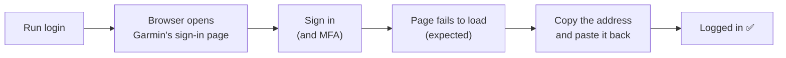

# Quick start

Log in to Garmin, check it works, read your data, then ask an AI app about it. Takes about ten minutes.

_Written October 2026. stride-mcp logs in, reads your activities, daily summary and sleep on the command line, and serves them to an AI app over MCP._

## You need

- **Java 25** (`java -version` to check)
- A **Garmin Connect** account
- A Mac works best: stride-mcp opens your browser for you. On other systems, you copy the address yourself.

## 1. Build it

```
cd ~/Development/source/stride-mcp
./mvnw package
```

This makes `target/stride-mcp.jar`. Optional shortcut, so the commands below work as written:

```
alias stride-mcp='java -jar ~/Development/source/stride-mcp/target/stride-mcp.jar'
```

## 2. Log in

```
stride-mcp login
```



1. Your browser opens Garmin's sign-in page. Sign in as normal.
2. The browser then **fails to load a page**. That's expected. If it warns the connection isn't secure, **don't click Continue**.
3. Copy the **whole address** from the address bar. It contains `ticket=ST-…`.
4. Paste it into the terminal and press Enter.

You'll see something like:

```
Logged in as Jo Runner.
Tokens saved to /Users/you/.stride-mcp/garmin_tokens.json
Access token valid until Sat 24 Oct 2026, 05:12 (refreshed automatically).
Session valid until Sun 22 Nov 2026, 08:12. Use stride-mcp before then to keep it going.
```

stride-mcp never sees your password. It only gets a one-time ticket from that address.

## 3. Check it

```
stride-mcp whoami
```

This prints who you're logged in as. It refreshes the login by itself when needed.

**Use stride-mcp at least once every 30 days** and you shouldn't need to log in again.

## 4. Read your data

Six commands. The examples come from real Garmin replies (October 2026, and November 2026 for weight and the daily log).

| Command | Shows |
|---|---|
| `activities [--days N] [--type T]` | Your activities, newest first |
| `activity <id>` | One activity, with its laps |
| `summary [date]` | One day's totals, last night's sleep, and weight |
| `sleep [date]` | One night's sleep |
| `weight [from] [to]` | Weight and body composition for each day, and the change |
| `log [from] [to]` | Each day's sleep, steps, calories eaten, activities and weight, for a health log. Default yesterday, at most 28 days. |

### Activities

```
$ stride-mcp activities --days 7 --type running
Date        Type     Name               Distance  Time   Pace      Avg HR  Id
Thu 22 Oct  running  Islington Running   5.05 km  36:01  7:08 /km  143     24810777073
Sun 18 Oct  running  Islington Running   8.01 km  53:51  6:43 /km  149     24765567036
2 running activities in the last 7 days (Sat 17 Oct to Fri 23 Oct).
```

Without options, it shows every type for the last 7 days. The last column is the id for `activity`.

### One activity

```
$ stride-mcp activity 24816092240
Stair Stepper
Start            Thu 22 Oct 2026, 17:04
Type             stair_climbing
Id               24816092240
Time             10:02
Heart rate       avg 142, max 158 bpm
Calories         133 kcal
Training effect  2.0 aerobic, 0.0 anaerobic
Training load    22

Lap  Distance  Time   Pace  Avg HR  Max HR  Elevation
1           –  10:02  –     142     158     –
```

`–` means Garmin has no value. A run also shows distance, pace, elevation gain, cadence and power, and its laps fill in distance, pace and elevation. The start is the time on the clock where you did it.

### Daily summary

```
$ stride-mcp summary 2026-10-23
Fri 23 Oct 2026
Steps            3,532 (goal 11,190)
Distance         3.18 km
Calories         1,417 kcal (222 active)
Heart rate       resting 45, min 43, max 130 bpm
…
Sleep            8:52:00, score 91 (Excellent)
Weight           75.4 kg
  Body fat       18.6%
  Muscle mass    33.1 kg (44% of weight)
…
```

It also shows stress, Body Battery, intensity minutes and floors climbed. Sleep is the night that ended that morning. Weight is that day's first weigh-in, and body composition the first your scale sent that day (if you typed a weight in first, they come from different weigh-ins, and it says so). A weight typed in has only a BMI, so it never counts as body composition. A part with no data is left out. If Garmin's reply for sleep or weight can't be read, that part is left out with a line saying why, and you still get the totals. With no date, it's today.

### Sleep

```
$ stride-mcp sleep 2026-10-23
Night ending Fri 23 Oct 2026
Start            Thu 22 Oct, 22:37
End              Fri 23 Oct, 07:37
Asleep           8:52:00
  Deep           1:31:00
  Light          4:55:00
  REM            2:26:00
Awake            0:08:00
Score            91 (Excellent)
Respiration      12 breaths/min
SpO2             97% average
```

Sleep times are always `h:mm:ss`, so `0:08:00` is 8 minutes. With no date, it's last night.

### Weight

```
$ stride-mcp weight 2026-10-22 2026-11-20
Date        Time    Weight  Body fat  Body water   Muscle    Bone  BMI   Weigh-ins
Fri 23 Oct  07:37  75.7 kg  18.0%     55.3%       33.0 kg  3.2 kg  23.4  1
Sat 14 Nov  08:31  75.8 kg  –         –                 –       –  23.4  2
Tue 17 Nov  07:15  76.0 kg  18.0%     55.3%       33.0 kg  3.2 kg  23.5  1
Fri 20 Nov  08:35  76.1 kg  18.0%     55.3%       33.0 kg  3.2 kg  23.5  1
4 days with a weigh-in from Thu 22 Oct to Fri 20 Nov.
First 75.7 kg (Fri 23 Oct), last 76.1 kg (Fri 20 Nov): +0.4 kg.
Lowest 75.7 kg (Fri 23 Oct), highest 76.1 kg (Fri 20 Nov).
```

One line per day with a weigh-in. Days without one are left out. A day's weight is its **first** weigh-in, as in `summary`. A `*` after the count means that day's body composition came from another weigh-in. A column your scale never filled in is left out. The 14 November weights were typed in on Garmin Connect, so they have only the BMI Garmin works out.

| You type | You get |
|---|---|
| `weight` | The last 30 days, today included |
| `weight 2026-09-01` | 1 September to today |
| `weight 2026-09-01 2026-09-30` | September. At most 367 days, so a year to the same date always fits. |

### Daily log

Everything Garmin has for each day, for filling in a health log. Here on the evening of 20 November 2026:

```
$ stride-mcp log 2026-11-12 2026-11-20
Date         Sleep  Hours   Steps  Calories eaten   Weight  Body fat   Muscle  Weighed  Weigh-ins
Thu 12 Nov      50    6.6  14,239               –        –         –        –  –        –
Fri 13 Nov       –      –       –               –        –         –        –  –        –
Sat 14 Nov       –      –       –               –  75.8 kg         –        –  08:31    2
Sun 15 Nov       –      –       –               –        –         –        –  –        –
Mon 16 Nov       –      –       –               –        –         –        –  –        –
Tue 17 Nov       –      –       –               –  76.0 kg     18.0%  33.0 kg  07:15    1
Wed 18 Nov       –      –       –               –        –         –        –  –        –
Thu 19 Nov      49    7.7   6,352      2,667 kcal        –         –        –  –        –
Fri 20 Nov*     95   10.0      95      2,442 kcal  76.1 kg     18.0%  33.0 kg  08:35    1
* Not final: Garmin may still add to it, so don't log it yet.

Date        Type               Group              Minutes  Name            Id
Thu 12 Nov  running            running               49.9  London Running  1
Thu 19 Nov  treadmill_running  running               30.0  Treadmill       2
Thu 19 Nov  strength_training  fitness_equipment     70.1  Strength        3

9 days from Thu 12 Nov to Fri 20 Nov.
Sleep is the night that ended that morning. Calories eaten are food logged, not burned.
```

One row per day, every day, oldest first, then the day's activities. The sleep, steps, calories eaten and weigh-ins come from real Garmin replies (20 November 2026), but trimmed to a few days, so the empty rows here would have numbers. The activities are made up.

- **Final:** a `*` marks a day that may still change, so don't log it yet: today, or a past day your watch hasn't synced since. A past one also gets a line saying where its watch data stops, such as "Fri 20 Nov: the watch's data stops at 08:42". Sync the watch, then run `log` again with `--no-cache`.
- **Sleep** is the night that ended that morning, as in `sleep`. Hours and minutes are to 1 decimal place, as a spreadsheet has them.
- **Calories eaten** is the food you logged (MyFitnessPal's daily total, synced to Garmin). It's never calories burned. A day with nothing logged shows `–`, like 12 November.
- **Weight** is the day's first weigh-in, and body fat and muscle the first scale reading, as in `weight`. 14 November's two weights were typed in, so they have no body composition.
- **Group** is Garmin's top-level type, so a treadmill run is still `running`. **Minutes** is the whole time, not the moving time.

| You type | You get |
|---|---|
| `log` | Yesterday |
| `log 2026-11-08` | 8 November to yesterday. If the date is today, just today. |
| `log 2026-11-08 2026-11-14` | That week. At most 28 days, and none after today. |

### Dates and options

| Thing | Means |
|---|---|
| Today | Today in your **Garmin profile's** time zone, not your computer's |
| A date | Looks like `2026-10-22` |
| `--days 7` | Today and the 6 days before. From 1 to 90. |
| `sleep 2026-10-23` | The night that **ended** that morning (22–23 October) |
| `--type running` | Garmin's name for the type: `running`, `cycling`, `trail_running`… The Type column shows them. |

`--days` and `--type` work with a space or `=` (`--days 7` or `--days=7`). Not yet checked (October 2026): whether `--type running` also finds trail and treadmill runs.

### The cache

Garmin's replies are kept on disk, so running a command again answers from there and doesn't ask Garmin.

| What | Kept for |
|---|---|
| Anything for today or yesterday | 10–15 minutes |
| An older day's summary, sleep or weight | 30 days |
| An older list of activities | 1 day |
| Older weigh-ins over a range (`weight`), and older steps and sleep over a range (`log`) | 1 day, or 1 hour if there were none |
| An older `log` range with a day your watch hasn't synced since | Its steps, sleep and activities 10–15 minutes, so a sync shows soon |
| Garmin's list of activity types (`log`) | 30 days |
| One activity | 7 days |

Add `--no-cache` to ask Garmin anyway. The new reply is still saved. The full rules are in [Phase 2: Data](phases/phase-2-data.md#caching).

If the cache folder can't be used, the command prints one line saying why (starting "Not using the cache") and still works. It just asks Garmin each time.

## 5. Use it from an AI app

An AI app such as Claude Code starts stride-mcp itself, and asks it for your data when your question needs it. Log in first (step 2): the AI app can't do that part.

Add it to Claude Code:

```bash
claude mcp add --scope user stride -- "$(/usr/libexec/java_home -v 25)/bin/java" -jar ~/Development/source/stride-mcp/target/stride-mcp.jar serve
```

Then start `claude` and ask:

> How was my training this week?

Claude Desktop, Codex CLI, the settings, and what to do if it doesn't connect: [Running it](running.md#1-stdio-recommended).

### What the AI can do

stride-mcp gives the AI six **tools**. It picks the ones your question needs.

| Tool | Answers | Ask, for example |
|---|---|---|
| `get_activities` | Your activities between two dates (up to 90 days) | "How far did I run in September?" |
| `get_activity` | One activity in detail: laps, heart rate, cadence, power, training effect | "How even were my laps on Thursday's run?" |
| `get_daily_summary` | One day's steps, calories, heart rate, stress, Body Battery, and weight | "How active was I yesterday?" |
| `get_sleep` | One night's sleep: times, stages, score | "How did I sleep last night?" |
| `get_weight` | Weight and body composition for each day with a weigh-in (up to 367 days), with the change, lowest and highest | "How has my weight changed since September?" |
| `get_daily_log` | Everything Garmin has for each day of a health log (up to 28 days): sleep score and hours, steps, calories eaten, activities and weight | "Fill in my health log for yesterday." |

They only read: nothing is changed in Garmin Connect. Replies use the same cache as the commands. Say "I just synced my watch" to make the AI ask Garmin again. What each tool sends back, in detail: [Phase 3: MCP server](phases/phase-3-mcp.md#the-tools), for `get_weight`, [Phase 4a: Weight](phases/phase-4a-weight.md#the-tool-get_weight), and for `get_daily_log`, [Phase 4b: Daily log](phases/phase-4b-daily-log.md#the-tool-get_daily_log).

## 6. Log out (optional)

```
stride-mcp logout
```

This deletes the saved login, and the cache of your Garmin data.

## If something goes wrong

| You see | Do this |
|---|---|
| "No ticket found" | Copy the **full** address from the address bar, not the page text |
| "Garmin didn't accept that ticket" | Tickets work once. Run `login` again. |
| "Garmin is rate limiting" / "HTTP 403" | Wait an hour or more. Don't keep retrying. |
| "Not logged in" | Run `stride-mcp login` |
| "Session expired" | Run `stride-mcp login` |
| "app IDs may have changed" | Garmin changed its login. Check for an update to stride-mcp. |
| "Token file … is unreadable" | Run `stride-mcp logout`, then `stride-mcp login` |
| "No activity with id …" | Copy the id from `stride-mcp activities` |
| "Activity ids are numbers" | Use the number from the Id column |
| "Dates look like 2026-10-22" | Write the date as year-month-day |
| "--days must be between 1 and 90" | Pick a smaller number |
| "More than 200 activities" | Use a smaller `--days` |
| "Garmin wouldn't share the summary" | Run `stride-mcp login` again |
| "Garmin's reply … wasn't what stride-mcp expected" | Garmin changed something. Check for an update to stride-mcp. |

"No sleep recorded", "No data recorded" and "No activities" aren't errors. Garmin just has nothing for that time.

Problems in an AI app: see [Running it](running.md#if-something-goes-wrong).

## Good to know

- Your login is saved in `~/.stride-mcp/garmin_tokens.json`, readable only by you. Treat it like a password.
- Use `--stride.token-file=/some/path.json` to save it somewhere else.
- The cache is in `~/.stride-mcp/cache`, also readable only by you. It holds personal data (names, heart rate). `--stride.cache-dir=/some/folder` moves it. Pick a folder that doesn't exist yet: stride-mcp creates it, and won't use one it didn't make.
- Settings with a dot in the name, like `--stride.token-file`, need the `=` form.
- Output is metric: km, and pace in min/km.
- Switching to a different Garmin account? Run `stride-mcp logout` first, so the cache is cleared.
- Exit codes: `0` worked, `1` failed, `2` wrong usage.
- `stride-mcp --help` lists every command.

## Next

- How the login works, in detail: [Phase 1: Login](phases/phase-1-login.md)
- How the data commands work, and the cache: [Phase 2: Data](phases/phase-2-data.md)
- Every way to connect an AI app, and what to do when it doesn't: [Running it](running.md)
- How the MCP server and its tools work: [Phase 3: MCP server](phases/phase-3-mcp.md)
- What comes after: [Project plan](project-plan.md)
