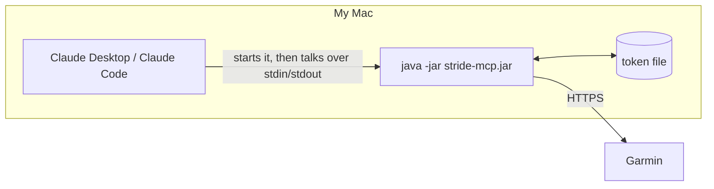

# Running it

stride-mcp runs on my own Mac. There are three ways to set it up.

| Option | Who starts it | Reachable from | Effort |
|---|---|---|---|
| **1. stdio** (start here) | The AI app, when needed | This Mac only | Lowest |
| **2. Local HTTP** | Me | This Mac only | Low |
| **3. Hosted online** | Always running on a server | Anywhere, including phone and web | High |

## Which AI apps work with which option

_Checked October 2026. AI apps change their MCP support often._

| AI app | stdio | Local HTTP | Hosted online |
|---|---|---|---|
| Claude Code | ✅ | ✅ | ✅ |
| Claude Desktop | ✅ | ✅ | ✅ |
| OpenAI Codex CLI | ✅ | ✅ | ✅ |
| ChatGPT (web, desktop, phone) | ❌ | ❌ | ✅ (Developer Mode, paid plans) |
| claude.ai (web, phone) | ❌ | ❌ | ✅ |

**Using it from ChatGPT means hosting it online** (option 3). For testing, a tunnel (such as ngrok) can give a local server a temporary public address.

## 1. stdio (recommended)

The AI app starts the server itself. Nothing runs in the background, and no network port is opened.



**Setup:**

1. Build the jar: `./mvnw package`
2. Tell the AI app how to start it.

**Claude Code:**

```
claude mcp add stride -- java -jar /Users/james/Development/source/stride-mcp/target/stride-mcp.jar
```

**Claude Desktop:** add this to its config file (Settings → Developer → Edit Config):

```json
{
  "mcpServers": {
    "stride": {
      "command": "java",
      "args": ["-jar", "/Users/james/Development/source/stride-mcp/target/stride-mcp.jar"]
    }
  }
}
```

**Watch out:** in stdio mode, the server's console output is how it talks to the AI app. The Spring Boot banner and console logs must be switched off, and logs written to a file instead. Otherwise the connection breaks.

## 2. Local HTTP

I start the server myself and the AI app connects to an address on this Mac, such as `http://localhost:8080/mcp`.

- **Good for:** keeping it running, sharing it between several apps, watching logs while developing
- **Downside:** I have to start it, or set it to start when I log in

## 3. Hosted online

Needed for **ChatGPT**, and for **claude.ai on the web or on my phone**, since those can't reach my Mac.

It needs:

- a server or cloud host to run on
- proper login (OAuth), so only I can use it
- my Garmin tokens stored on that host, which is a security trade-off

Planned for phase 5.

## Plan

Use **stdio** for phases 1 to 4 (see [Project plan](project-plan.md)), tested with Claude and Codex CLI. Add hosting in phase 5 for ChatGPT. The tools work the same with every option, so the switch is mostly configuration plus adding a login for the hosted version.
