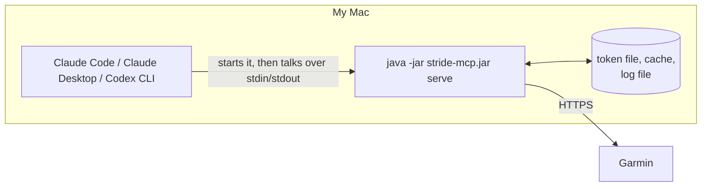

# Running it

stride-mcp runs on my own Mac. There are three ways to set it up.

| Option | Who starts it | Reachable from | Effort |
|---|---|---|---|
| **1. stdio** (start here) | The AI app, when needed | This Mac only | Lowest |
| **2. Local HTTP** | Me | This Mac only | Low |
| **3. Hosted online** | Always running on a server | Anywhere, including phone and web | High |

## Which AI apps work with which option

_Checked October 2026. AI apps change their MCP support often._

| AI app | stdio | Local HTTP | Hosted online |
|---|---|---|---|
| Claude Code | ✅ | ✅ | ✅ |
| Claude Desktop | ✅ | ✅ | ✅ |
| OpenAI Codex CLI | ✅ | ✅ | ✅ |
| ChatGPT (web, desktop, phone) | ❌ | ❌ | ✅ (Developer Mode, paid plans) |
| claude.ai (web, phone) | ❌ | ❌ | ✅ |

**Using it from ChatGPT means hosting it online** (option 3). For testing, a tunnel (such as ngrok) can give a local server a temporary public address.

## 1. stdio (recommended)

The AI app starts the server itself, with `serve`. Nothing runs in the background, and no network port is opened.



### Before you start

1. Do the [quick start](quick-start.md) up to **Check it**: build the jar, run `stride-mcp login`, then `stride-mcp whoami`.
2. Find your Java 25. AI apps don't always start programs with your terminal's settings, so give them its full path:

   ```bash
   /usr/libexec/java_home -v 25
   ```

   Add `/bin/java` to what it prints. For example: `/Library/Java/JavaVirtualMachines/temurin-25.jdk/Contents/Home/bin/java`.

The server can't log in by itself: the browser sign-in and paste need a terminal. If it says you're not logged in, run `stride-mcp login` in a terminal and ask again. No restart needed.

### Claude Code

```bash
claude mcp add --scope user stride -- "$(/usr/libexec/java_home -v 25)/bin/java" -jar ~/Development/source/stride-mcp/target/stride-mcp.jar serve
```

`--scope user` makes it work in every folder. Without it, only in the folder you ran this in. Type `/mcp` in Claude Code to see that `stride` is connected.

### Claude Desktop

Settings → Developer → Edit Config opens `~/Library/Application Support/Claude/claude_desktop_config.json`. Add a `stride` entry under `mcpServers` (add `mcpServers` if it isn't there yet):

```json
{
  "mcpServers": {
    "stride": {
      "command": "/Library/Java/JavaVirtualMachines/temurin-25.jdk/Contents/Home/bin/java",
      "args": ["-jar", "/Users/you/Development/source/stride-mcp/target/stride-mcp.jar", "serve"]
    }
  }
}
```

Use your own Java path and home folder: `~` doesn't work here. Then quit Claude Desktop fully (⌘Q) and open it again.

### Codex CLI

```bash
codex mcp add stride -- "$(/usr/libexec/java_home -v 25)/bin/java" -jar ~/Development/source/stride-mcp/target/stride-mcp.jar serve
```

This adds a server to `~/.codex/config.toml`, for every folder. Type `/mcp` in Codex to see it. To edit it by hand, it looks like this:

```toml
[mcp_servers.stride]
command = "/Library/Java/JavaVirtualMachines/temurin-25.jdk/Contents/Home/bin/java"
args = ["-jar", "/Users/you/Development/source/stride-mcp/target/stride-mcp.jar", "serve"]
```

Codex gives a server 10 seconds to start (`startup_timeout_sec`). stride-mcp takes about 2.

_AI app details checked 31 October 2026, with Claude Code 2.1 and Codex CLI 0.163._

### Settings

Add them after `serve`, with `=`. In JSON or TOML, each is its own item in `args`.

| Setting | Default | Changes |
|---|---|---|
| `--stride.token-file=…` | `~/.stride-mcp/garmin_tokens.json` | Where the login is saved. Log in with the same setting. |
| `--stride.cache-dir=…` | `~/.stride-mcp/cache` | Where Garmin's replies are kept. Pick a folder that doesn't exist yet. |
| `--stride.log-file=…` | `~/.stride-mcp/stride-mcp.log` | Where the server writes its log |

For example: `… stride-mcp.jar serve --stride.cache-dir=/Users/you/stride-cache`

### Good to know

- **Two kinds of log.** The server writes warnings, errors and one line per tool call to `~/.stride-mcp/stride-mcp.log`, readable only by you. Never tokens or Garmin's replies. If it can't start, it says why on stderr, which the AI app keeps (see below).
- **stdout is the connection.** stride-mcp keeps it clean itself: no banner, logs to a file, and anything else printed goes to stderr. If you start it through a script, don't let the script print anything.
- **A new login** works on the next question, with no restart.
- **Restart the AI app** after you rebuild the jar, or after switching Garmin account (`logout`, then `login`).
- Each AI app starts its own server (Claude Code and Codex: one per session). They share the login and the cache.

### If something goes wrong

The quickest check: run the command yourself in a terminal.

```bash
"$(/usr/libexec/java_home -v 25)/bin/java" -jar ~/Development/source/stride-mcp/target/stride-mcp.jar serve
```

If it's fine, it prints nothing and waits for an AI app. Press Ctrl-D to stop it. If not, it says why.

Where each app keeps the server's stderr (checked 31 October 2026):

| App | Look in |
|---|---|
| Claude Code | `/mcp`, then `~/Library/Caches/claude-cli-nodejs/<folder>/mcp-logs-stride/` |
| Claude Desktop | Settings → Developer, then `~/Library/Logs/Claude/mcp-server-stride.log` |
| Codex CLI | `/mcp`, or run the command in a terminal as above |

Messages you may see:

| You see | Do this |
|---|---|
| "Not logged in. Run `stride-mcp login`." | Run `stride-mcp login` in a terminal, then ask again |
| "Session expired. Run `stride-mcp login`." | The same |
| "Garmin is rate limiting. Wait a while (an hour or more) before trying again." | Wait. Don't keep asking: each question is a new try. |
| "Garmin refused the request … (HTTP 403). It may be blocking this connection." | Wait a while, as for rate limiting |
| "Token file … is unreadable. Run `stride-mcp logout`, then `stride-mcp login`." | Do that |
| "stride-mcp hit an unexpected error. Details are in …/stride-mcp.log." | A bug. The log says what happened. |
| "stride-mcp couldn't start the MCP server: …" (stderr) | The rest says why, for example "Couldn't prepare the log file …". Fix that, then restart the AI app. |
| "stride-mcp stopped: it couldn't read a message from the AI app. Details are in …" (stderr) | The app sent something stride-mcp couldn't read. Restart the app. If it happens again, the log has the details. |
| "UnsupportedClassVersionError … class file version 69.0" (stderr) | The app found an older Java. Use the full path to Java 25, as above. |
| The server shows as failed, with nothing in the log | The app couldn't find Java or the jar. Check both paths. |
| The AI answers without using stride-mcp | Check `/mcp` (or Settings → Developer). Ask more directly: "use stride to get my activities this week". |

The other messages, and what to do, are in [Phase 3: Errors](phases/phase-3-mcp.md#errors) and the [quick start](quick-start.md#if-something-goes-wrong).

## 2. Local HTTP

I start the server myself and the AI app connects to an address on this Mac, such as `http://localhost:8080/mcp`.

- **Good for:** keeping it running, sharing it between several apps, watching logs while developing
- **Downside:** I have to start it, or set it to start when I log in

## 3. Hosted online

Needed for **ChatGPT**, and for **claude.ai on the web or on my phone**, since those can't reach my Mac.

It needs:

- a server or cloud host to run on
- proper login (OAuth), so only I can use it
- my Garmin tokens stored on that host, which is a security trade-off

Planned for phase 5.

## Plan

Use **stdio** for phases 1 to 4 (see [Project plan](project-plan.md)), tested with Claude and Codex CLI. Add hosting in phase 5 for ChatGPT. The tools work the same with every option, so the switch is mostly configuration plus adding a login for the hosted version.
