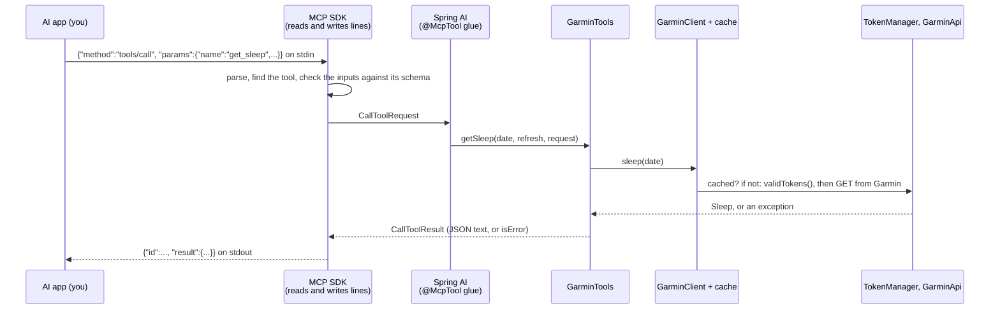

# Watch a tool call

A hands-on way to learn MCP. You play the AI app: you type MCP messages into `serve` yourself, then step through the code in IntelliJ's debugger as it answers.

_Written 20 November 2026, with MCP Java SDK 2.1.0 and Spring AI 2.0.2. Line numbers are from that day's code._

Parts 1 to 3 never reach Garmin. They use empty temp files, so there's no login, and they don't touch your real one. Part 4 uses your real data.

## The journey

An AI app and stride-mcp swap one JSON message per line. The app writes to stride-mcp's stdin, and stride-mcp answers on stdout.



## The messages

A whole MCP session is a handful of messages. Each request has an `id`, and its reply carries the same `id`.

| Message | Who sends it | What it's for |
|---|---|---|
| `initialize` | App | "Hello, I speak this MCP version." The reply gives the server's name, what it offers (tools only here), and `instructions` for the AI. |
| `notifications/initialized` | App | "Ready." A notification: it has no `id` and gets no reply. |
| `tools/list` | App | "What can you do?" The reply gives each tool's name, description and input schema. This is all the AI knows about the tools. |
| `tools/call` | App | "Run this tool with these inputs." The reply is the tool's result. |
| Closing stdin | App | "Goodbye." `serve` stops. |

## Part 1: talk to it by hand

Build the jar if you haven't since the last change:

```bash
./mvnw package -DskipTests
```

Start `serve` with every file in a play folder:

```bash
"$(/usr/libexec/java_home -v 25)/bin/java" -Dhttps.proxyHost=127.0.0.1 -Dhttps.proxyPort=1 -Dhttp.proxyHost=127.0.0.1 -Dhttp.proxyPort=1 -jar ~/Development/source/stride-mcp/target/stride-mcp.jar serve --stride.token-file=/tmp/stride-play/tokens.json --stride.cache-dir=/tmp/stride-play/cache --stride.log-file=/tmp/stride-play/stride-mcp.log
```

The `proxy` settings point at a proxy that doesn't exist, so anything that tried to reach the internet would fail. The tests use the same trick. The token file doesn't exist, so stride-mcp is "not logged in".

It prints nothing and waits. Paste these, one line at a time, pressing Return after each:

```json
{"jsonrpc":"2.0","id":1,"method":"initialize","params":{"protocolVersion":"2025-06-18","capabilities":{},"clientInfo":{"name":"me","version":"1"}}}
{"jsonrpc":"2.0","method":"notifications/initialized"}
{"jsonrpc":"2.0","id":2,"method":"tools/list"}
{"jsonrpc":"2.0","id":3,"method":"tools/call","params":{"name":"get_sleep","arguments":{"date":"yesterday"}}}
{"jsonrpc":"2.0","id":4,"method":"tools/call","params":{"name":"get_sleep","arguments":{}}}
{"jsonrpc":"2.0","id":5,"method":"tools/call","params":{"name":"get_activity","arguments":{}}}
{"jsonrpc":"2.0","id":6,"method":"tools/call","params":{"name":"get_weather","arguments":{}}}
{"jsonrpc":"2.0","id":7,"method":"resources/list"}
```

Press **Ctrl-D** to close stdin. That ends the session, as an AI app does.

What comes back (shortened):

| id | Reply | Who wrote it |
|---|---|---|
| 1 | `"serverInfo":{"name":"stride-mcp",…}`, `"capabilities":{"tools":…}`, `"instructions":"Garmin data for the owner…"` | The SDK, from `application-serve.properties` |
| 2 | The tools, each with its `description` and `inputSchema` | Spring AI, from the `@McpTool` and `@McpToolParam` annotations |
| 3 | `"isError":true`, "`date` isn't a date. Dates look like 2026-10-22." | `GarminTools`, before anything reaches Garmin |
| 4 | `"isError":true`, "Not logged in. Run `stride-mcp login`." | `TokenManager`, worded for the AI by `GarminTools` |
| 5 | `"isError":true`, "Tool (get_activity) input validation failed: … required property 'id' not found" | The SDK, from the schema. Our code never runs. |
| 6 | `"error":{"code":-32602,"message":"Unknown tool: invalid_tool_name",…}` | The SDK |
| 7 | `"error":{"code":-32601,"message":"Method not found: resources/list"}` | The SDK: stride-mcp offers tools only |

Two kinds of failure are worth noticing:

- **A tool error** (3, 4, 5) is a normal `result` with `"isError":true`. The AI reads the message and can act on it, for example by fixing the date or telling you to log in.
- **A protocol error** (6, 7) is a JSON-RPC `error`. It means the app asked for something that doesn't exist. AI apps usually show it as a failure, not to the AI.

### See what the SDK received (optional)

Add `--logging.level.io.modelcontextprotocol=DEBUG` to the end of the command, and in another terminal tab:

```bash
tail -f /tmp/stride-play/stride-mcp.log
```

Each message shows up three times as the SDK takes it apart: the raw line, the parsed message, then the request or notification. The thread names tell you something too. Lines are read on `pool-2-thread-1`, and each tool call runs on its own `boundedElastic-N` thread. That's why calls sent together run at the same time.

This puts your inputs in the log, which stride-mcp normally avoids. Only use it with the play folder.

## Part 2: step through it in IntelliJ

Start the same command, with the debugger switched on:

```bash
"$(/usr/libexec/java_home -v 25)/bin/java" -agentlib:jdwp=transport=dt_socket,server=y,suspend=y,quiet=y,address=localhost:5005 -Dhttps.proxyHost=127.0.0.1 -Dhttps.proxyPort=1 -Dhttp.proxyHost=127.0.0.1 -Dhttp.proxyPort=1 -jar ~/Development/source/stride-mcp/target/stride-mcp.jar serve --stride.token-file=/tmp/stride-play/tokens.json --stride.cache-dir=/tmp/stride-play/cache --stride.log-file=/tmp/stride-play/stride-mcp.log
```

- `suspend=y`: Java waits for IntelliJ before running anything, so you can watch startup too.
- `quiet=y` matters. Without it, Java prints "Listening for transport…" to **stdout**, the MCP channel. An AI app would read that as a broken message.

In IntelliJ:

1. **Run → Edit Configurations → + → Remote JVM Debug.** Name it "stride serve", port `5005`, module classpath `stride-mcp`. Save.
2. Set the breakpoints below.
3. Choose "stride serve" and click **Debug**. The server starts.
4. Paste the messages from part 1 into the terminal, one at a time, and watch where each one stops.

To open an SDK or Spring AI class, press ⌘O twice (that includes libraries) and type its name. If IntelliJ offers **Download Sources**, take it.

### Breakpoints, in the order a `tools/call` meets them

| # | Where | Look at |
|---|---|---|
| 1 | `StdioServerTransportProvider` line 243 (SDK) | `line`: the exact text you pasted. One line is one message. |
| 2 | `McpServerSession` line 277 (SDK) | `request.method()` and `request.id()`. `initialize` is handled right here. Everything else is looked up by method name at line 290. |
| 3 | `McpAsyncServer` line 588 (SDK) | `tool`: its input schema. This is where message 5 is refused. Step over: `validationError` is null when the inputs fit. |
| 4 | `SyncMcpToolMethodCallback` line 97 (Spring AI) | `args`: the JSON inputs turned into Java values, ready for our method |
| 5 | [GarminTools.java:206](../src/main/java/com/hammez/stride/mcp/GarminTools.java:206) | Our code starts. Step into `work.get()` to reach the tool, for example `getSleep` at line 191. |
| 6 | [GarminClient.java:245](../src/main/java/com/hammez/stride/garmin/GarminClient.java:245) | The Garmin layer. `cached(…)` (line 362) decides between the cache and Garmin. |
| 7 | [TokenManager.java:48](../src/main/java/com/hammez/stride/garmin/auth/TokenManager.java:48) | No token file, so `NotLoggedInException`. Step on and watch it land in the `catch (GarminException e)` in `GarminTools.call`. |
| 8 | [GarminTools.java:207](../src/main/java/com/hammez/stride/mcp/GarminTools.java:207) | On success, the reply is built as JSON text |
| 9 | `StdioServerTransportProvider` line 291 (SDK) | `jsonMessage`: the exact line about to go out on stdout |

Tips:

- The call stack is deep, with many `reactor.*` frames between the SDK and our code. That's the SDK's plumbing. Look for frames in `io.modelcontextprotocol`, `org.springframework.ai.mcp` and `com.hammez.stride`.
- `initialize` and `tools/list` stop at 1, 2 and 9 only. Only `tools/call` reaches our code.
- Breakpoint 1 is on the thread that reads stdin. While you're paused there, nothing else is read.
- Click **Resume** when you're done with a message, or the next one waits.

## Part 3: get past the login, with the fake Garmin

Part 2 stops at "Not logged in". To watch a call go all the way through the cache and over HTTP, debug a test instead. The tests run a fake Garmin (`FakeGarmin`, a tiny web server on this computer) with fake tokens and real replies saved in `src/test/resources/garmin/`.

1. Open [GarminToolsTest.java](../src/test/java/com/hammez/stride/mcp/GarminToolsTest.java) and find `sleepFromTheRealReply` (line 347).
2. Set breakpoints 5 to 8 from the table, plus [GarminApi.java:47](../src/main/java/com/hammez/stride/garmin/auth/GarminApi.java:47), where the HTTP request goes out.
3. Right-click the test → **Debug**.

This test runs in one JVM, so every breakpoint works with no setup. It calls the tool the way the server does (through Spring AI's callback, breakpoint 4) but skips the JSON-RPC lines and the SDK's schema check (breakpoints 1 to 3).

Good ones to try next:

| Test | Shows |
|---|---|
| `refreshAsksGarminEvenWithAFreshCopyAndEachToolPassesItOn` | The cache being skipped |
| `rateLimitedOnceWithNoRetry` | A 429 from Garmin turned into a message for the AI |
| `sessionExpired` | A refresh that Garmin turns down |

`ServeModeTest` is the other end-to-end test. It starts `serve` as a separate Java process and talks to it over stdin and stdout, as in part 1. Breakpoints in the server code don't stop there, because it's another process. It's still worth reading, to see the messages a test sends.

## Part 4: a real AI app, with your real data (you run this)

This calls Garmin for real, and refreshes your token if it needs to. Replies are cached, so asking the same thing twice is free. Log in first (`stride-mcp login`) if `stride-mcp whoami` says you need to.

Save this as `/tmp/stride-play/debug-mcp.json`, with your own Java path (from `/usr/libexec/java_home -v 25`, plus `/bin/java`):

```json
{
  "mcpServers": {
    "stride": {
      "command": "/Library/Java/JavaVirtualMachines/temurin-25.jdk/Contents/Home/bin/java",
      "args": ["-agentlib:jdwp=transport=dt_socket,server=y,suspend=n,quiet=y,address=localhost:5005",
               "-jar", "/Users/you/Development/source/stride-mcp/target/stride-mcp.jar", "serve"]
    }
  }
}
```

Start Claude Code with only that server:

```bash
claude --strict-mcp-config --mcp-config /tmp/stride-play/debug-mcp.json
```

Attach "stride serve" from part 2, set breakpoint 5, and ask "how did I sleep last night?". You'll see the call Claude chose to make, with the inputs it picked, then the reply it gets.

- `suspend=n` this time: the app expects the server to answer straight away, and gives up if it doesn't.
- Only one server can use port 5005 at a time. A second Claude Code session started this way can't start its stride server.
- Don't stay paused too long. The app may give up on the call.
- Your usual `stride` setup is untouched. Without `--strict-mcp-config`, Claude Code uses it as normal.
